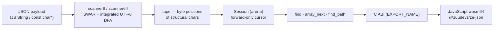

# ze_json

> **High-performance on-demand JSON parser** — SWAR scanner + structural
> tape, zero-copy reads with no per-value allocation, arena allocator, and
> a **Raw WebAssembly memory64** binding (no Emscripten) for JavaScript.


*This document is also available in [Bahasa Indonesia](README.md).*

---

## Overview

`ze_json` is built on two simple ideas:

1. **Scan once, read on demand.** The SWAR scanner validates the whole
   payload (UTF-8, strings, brackets) and **records a tape** — the byte
   position of every structural character — *without building a tree*.
   Values are parsed only when read; strings are **never copied**
   (zero-copy); unescaping runs only when needed, allocating from the arena.
2. **Everything allocates from the arena.** The `Session`, unescaped
   strings and lazy indexes live in one bump-allocator arena; the next
   document cycle only needs `reset_arena` — a hot loop with **zero
   allocations**.



## Performance (measured)

Full data is committed under [`out/results/benchmark/`](out/results/benchmark);
the noise-resistant methodology (single process, within-run ratios) is
described in [docs/architecture/optimizations.md](docs/architecture/optimizations.md)
*(in Indonesian)*.

| Aspect | Result |
|---|---|
| Scanner throughput | **1.1–1.3 GB/s** across all datasets (61 MB corpus) |
| C++ pipeline per small document | create (scan + Session) **~200 ns** · find×3 + getters **411 ns** |
| Far keys of wide objects / far array elements | **O(1)** after lazy indexing — ×54–366 / ×40–75 (4-stage optimization) |
| UTF-8-dense payload | **−42.7%** E2E vs separate validation pass (integrated validation) |
| JS size sweep (vs `JSON.parse`) | ze wins from **268 B** (pure scan) / **1 KiB** (read 2 fields) — **~2.7× faster** at 256 KiB; the tiny regime (≲300 B) loses to fixed wasm overhead |

## Quick start

```bash
# Requirements: CMake ≥ 3.40, clang (LLVM) toolchain, Node.js ≥ 24 (JS path)
cmake --preset native-release && cmake --build build/native-release
cmake --preset wasm64-release && cmake --build build/wasm64-release
```

```js
import { ZeJson } from "@zuudevs/ze-json";
const ze = await ZeJson.load();
const doc = ze.openDocument('{"id":21,"colors":["white","black"]}');
doc.intAt("id");           // → { status: "OK", value: 21 }
doc.stringAt("colors[1]"); // → { status: "OK", value: "black" }
```

## Documentation

The detailed documentation set lives under [`docs/`](docs)
*(in Bahasa Indonesia)*:

| Document | Contents |
|---|---|
| [docs/architecture/overview.md](docs/architecture/overview.md) | overview, pipeline, repo layout, design principles, limitations |
| [docs/architecture/scanner.md](docs/architecture/scanner.md) | SWAR scanner, tape format, integrated UTF-8 validation |
| [docs/architecture/session.md](docs/architecture/session.md) | forward-only cursor, array traversal (counted/streaming), path queries |
| [docs/architecture/optimizations.md](docs/architecture/optimizations.md) | 4-stage optimization + benchmark evidence + JS size sweep |
| [docs/architecture/js-binding.md](docs/architecture/js-binding.md) | wasm64 memory layout, binding contract, npm package |
| [docs/development/workflow.md](docs/development/workflow.md) | dev cycle, build presets, CI, npm release, daily gotchas |
| [docs/development/naming.md](docs/development/naming.md) | naming & code style conventions, commit messages, Mermaid |
| [docs/development/testing.md](docs/development/testing.md) | testing philosophy, 7-group map, JS smoke, adding tests & pitfalls |
| [docs/development/benchmarking.md](docs/development/benchmarking.md) | noise-resistant measurement rules, conventions & artifacts, new-benchmark recipe |
| [docs/api.md](docs/api.md) | full reference: Status, C ABI, C++, JavaScript |
| [docs/changelog.md](docs/changelog.md) | release history |

## Testing & benchmarks

```bash
node scripts/test_metrics.js native-debug native-release   # 45 tests × 2 presets
node scripts/benchmark_metrics.js native-release           # 3 groups, 69 benchmarks
cd js && npm test                                          # 40 smoke assertions
node benchmark/sizes.mjs                                   # size sweep vs JSON.parse
```

## License

MIT — [LICENSE](LICENSE)
