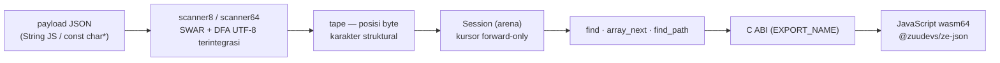

# ze_json

> **Parser JSON on-demand berperforma tinggi** — scanner SWAR + tape struktural,
> pembacaan zero-copy tanpa alokasi per-nilai, arena allocator, dan binding
> **Raw WebAssembly memory64** (tanpa Emscripten) untuk JavaScript.


*Dokumen ini tersedia juga dalam [English](README.en.md).*

---

## Gambaran

`ze_json` dibangun di atas dua ide sederhana:

1. **Discan sekali, baca on-demand.** Scanner SWAR memvalidasi seluruh payload
   (UTF-8, string, tanda kurung) dan **merekam tape** — daftar posisi byte
   setiap karakter struktural — *tanpa membangun tree*. Nilai hanya di-*parse*
   tepat ketika dibaca; string **tidak disalin** (zero-copy); unescape hanya
   berjalan bila perlu dan hasilnya dialokasikan dari arena.
2. **Semua alokasi dari arena.** `Session` + string unescape + indeks lazy
   hidup dalam satu arena bump-allocator; siklus dokumen berikutnya hanya
   butuh `reset_arena` — hot loop **tanpa alokasi**.



## Performa (hasil terukur)

Metrik lengkap ter-commit di
[`out/results/benchmark/`](out/results/benchmark); metodologi tahan-noise
(satu proses, rasio dalam-run) di
[docs/architecture/optimizations.md](docs/architecture/optimizations.md).

| Aspek | Hasil |
|---|---|
| Throughput scanner | **1,1–1,3 GB/s** di semua dataset (61 MB korpus) |
| Pipeline C++ per dokumen kecil | create (scan + Session) **~200 ns** · find×3 + getter **411 ns** |
| Kunci jauh objek lebar / elemen array jauh | **O(1)** pasca indeks lazy — ×54–366 / ×40–75 (4 tahap optimasi) |
| Payload UTF-8 padat | **−42,7%** E2E vs pass validasi terpisah (validasi terintegrasi) |
| Sapuan ukuran JS (vs `JSON.parse`) | scan murni menang di **semua ukuran teruji** (95 B–256 KiB; 0,57 vs 1,02 µs di 95 B); pola baca 2 field menang mulai **1 KiB** — di 256 KiB **~3,9× lebih cepat** |

**Empat tahap optimasi** (semua dengan benchmark before/after):
`e408674` scanner64 → `23a12ee` indeks root lazy → `47e9cb7` streaming
array → `8e0f3e3` validasi UTF-8 terintegrasi + indeks elemen array.

## Mulai cepat

```bash
# Kebutuhan: CMake ≥ 3.40, toolchain clang (LLVM), Node.js ≥ 24 (jalur JS)
cmake --preset native-release && cmake --build build/native-release
cmake --preset wasm64-release && cmake --build build/wasm64-release
```

```cpp
// C++ — alur per-langkah (kursor forward-only)
using namespace zuu;
auto* arena = create_arena(buffer, sizeof(buffer));
types::size_t tape[512];
api::Status st = api::OK;
auto* s = create_session(payload, len, tape, 512, arena, st);
find_field(s, "colors", 6);                  // → kursor di nilai
get_int_at(s, "position.x", 10, st);        // → 24: satu panggilan ABI
```

```js
// JavaScript (@zuudevs/ze-json)
import { ZeJson } from "@zuudevs/ze-json";
const ze = await ZeJson.load();
const doc = ze.openDocument('{"id":21,"colors":["white","black"]}');
doc.intAt("id");           // → { status: "OK", value: 21 }
doc.stringAt("colors[1]"); // → { status: "OK", value: "black" }
```

## Dokumentasi

| Dokumen | Isi |
|---|---|
| [docs/architecture/overview.md](docs/architecture/overview.md) | gambaran umum, pipeline, struktur repo, prinsip desain, batasan |
| [docs/architecture/scanner.md](docs/architecture/scanner.md) | scanner SWAR, format tape, validasi UTF-8 terintegrasi |
| [docs/architecture/session.md](docs/architecture/session.md) | kursor forward-only, traversal array (counted/streaming), path query |
| [docs/architecture/optimizations.md](docs/architecture/optimizations.md) | 4 tahap optimasi + bukti benchmark + sapuan ukuran JS |
| [docs/architecture/js-binding.md](docs/architecture/js-binding.md) | layout memori wasm64, kontrak binding, paket npm |
| [docs/development/workflow.md](docs/development/workflow.md) | siklus kerja, preset build, CI, rilis npm, gotcha harian |
| [docs/development/naming.md](docs/development/naming.md) | konvensi penamaan & gaya kode, pesan commit, Mermaid |
| [docs/development/testing.md](docs/development/testing.md) | filosofi uji, peta 7 grup, smoke JS, menambah uji + jebakan |
| [docs/development/benchmarking.md](docs/development/benchmarking.md) | aturan pengukuran tahan-noise, konvensi & artefak, resep benchmark baru |
| [docs/api.md](docs/api.md) | referensi lengkap: Status, C ABI, C++, JavaScript |
| [docs/changelog.md](docs/changelog.md) | riwayat rilis |

## Pengujian & benchmark

```bash
# Korpus benchmark: submodule samples/ (simdjson ~61 MB)
git clone --recurse-submodules https://github.com/zuudevs/ze_json.git
git submodule update --init --recursive   # bila sudah clone tanpa submodule

# 45 test per preset × 2 preset (7 grup, 1 kelompok = 1 folder)
node scripts/test_metrics.js native-debug native-release

# 3 grup benchmark (scanner 12 · parser 9 · session 48)
node scripts/benchmark_metrics.js native-release        # → out/results/benchmark/

# JS: 40 asersi smoke + benchmark
cd js && npm test
node benchmark/sizes.mjs        # sapuan ukuran vs JSON.parse
```

Analisis artefak (`out/results/`) tersedia via notebook
[`scripts/results_analysis.py`](scripts/results_analysis.py) — lihat
[docs/development/benchmarking.md](docs/development/benchmarking.md).

Disiplin lengkap (workflow, konvensi penamaan, cara menambah uji,
metodologi pengukuran tahan-noise) ada di
[docs/development/](docs/development/workflow.md).

## Batasan yang dikenal (ringkas)

Kunci exact-byte (kunci ber-escape tak cocok) · 1 Session = 1 root object ·
kursor forward-only (akses acak via path query) · payload binding JS ≤ 1 MiB ·
region tape 131.072 entri. Rincian di
[docs/architecture/overview.md](docs/architecture/overview.md#batasan-yang-dikenal).

## Lisensi

MIT — [LICENSE](LICENSE)
