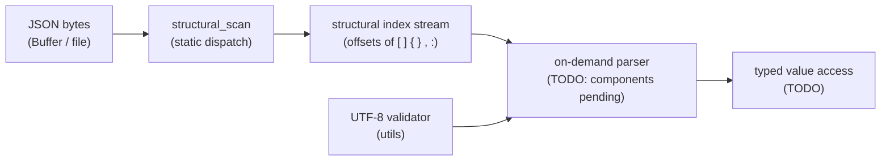
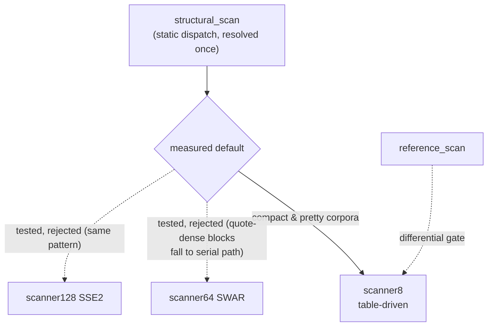
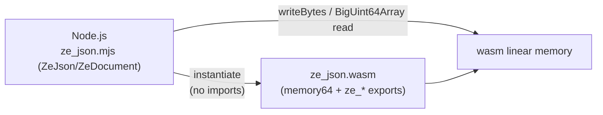

# Architecture

`ze_json` is a header-first C++23 library for **on-demand** JSON processing
(namespace `zuu`, no STL in core) with a raw wasm64 C-ABI surface for Node.js
integration. It is measured comparatively against the V8 baseline used by the
SAQ server (see `development/README.md` for the measurement workflow).

## 1. Layers

| Layer | Location | Contents |
|---|---|---|
| core | `include/ze_json/core/` | `Result<T,E>`, `JsonErrc`, integer aliases (`core::size_t`, `_u8` literals), `NOEXCEPT`/`RESTRICT`/`EXPORT_NAME`/`__LITTLE_ENDIAN__`/`__IS_64_BIT__` macros, `vec128` SIMD abstraction, generated lookup tables (`lookups.hpp`) |
| meta | `include/ze_json/meta/` | minimal type traits (`is_same`, `is_integral`, ...) replacing `<type_traits>` |
| utils | `include/ze_json/utils/` | SWAR byte-classification (`swar.hpp`), byte repeat, alignment, arena allocation, move/forward, UTF-8 validator |
| ondemand | `include/ze_json/ondemand/` | structural scanners (`scanner8`, `scanner64` SWAR, `scanner128` SSE2, `reference_scan`), static dispatch (`structural_scan`), arena |
| bindings | `src/bindings/cabi.cpp` | wasm64 C-ABI surface (compiled out on native) |
| memory | `include/ze_json/ondemand/arena.hpp` | bump `Arena` with finalizer list (no STL) |

## 2. Data flow

## 3. The scanner contract

Every scanner variant MUST reproduce `reference_scan()`
(`include/ze_json/ondemand/reference.hpp`) index-for-index and
error-for-error. The reference is deliberately table-free so a codegen bug
cannot corrupt the correctness anchor. Contract:

- output = byte offsets of `[ ] { } , :` occurring **outside** strings
- `"` toggles string state; `\` inside a string escapes the next byte
- errors (with precedence): `EmptyJson` (len 0) → `InvalidJson` (null
  source, dangling escape, unclosed string) → `InsufficientBuffer`
  (null/zero destination, capacity exhausted — `dst` then holds exactly
  `dst_cap` indices)
- UTF-8 validation and JSON grammar checks belong to later stages
- capacity overflow inside serial paths is propagated as
  `InsufficientBuffer` (regression-added in P4; previously silently ignored)

The differential gate (`tests/scanner_test.cpp`) runs fixtures, deterministic
fuzz (300+500 iterations), the full json_checker corpus (with documented RFC
8259 legacy exceptions `fail1`/`fail18`), and a 256-byte validation of the
generated `kJsonCharClass` table itself — across **all** variants.

## 4. Scanner variants & the measured decision

| Variant | Technique | Status |
|---|---|---|
| `reference_scan` | plain byte loop, char compares | correctness anchor |
| `scanner8` | table-driven (`kJsonCharClass`), 1 L1 load + 2 masked tests per byte | **dispatch default** (measured winner) |
| `scanner64` | SWAR 8-lane, three-path (fast outside / fast inside / serial) | tested, **rejected** (loses on 5/6 corpora) |
| `scanner128` | SSE2 16-lane, three-path, `cmpeq`+`movemask` | tested, **rejected** (loses on 5/6 corpora) |
| `structural_scan` | static dispatch, resolved once | production entry point |

Why the vector variants lose on compact JSON: quotes appear every ~6–15
bytes, so nearly every 8/16-byte block contains one and falls to the serial
path; the vector classification (6× SWAR eq, 12 cmpeq ops) then costs more
than `scanner8`'s single L1 table load per byte. Full tables and analysis:
`reports/P4-bottleneck-report.md` (workspace root). Future work to actually
beat the table-driven scanner requires a simdjson-style full-mask pipeline
(prefix-xor quote mask + SIMD escape-run handling), not a three-path hybrid.

## 5. wasm64 C-ABI surface

`src/bindings/cabi.cpp` compiles to real exports only on wasm targets
(`EXPORT_NAME`), and compiles out on native. Contract (mirrored by
`bindings/js/ze_json.mjs`):

| Export | Signature | Notes |
|---|---|---|
| `ze_abi_version` | `() -> u64` | currently 1 |
| `ze_alloc` | `(size) -> ptr` | 16-byte aligned bump allocator from linker `__heap_base` |
| `ze_reset_heap` | `() -> void` | rewind between corpora (no individual free) |
| `ze_scanner8` | `(src, len, dst, cap) -> u64` | packed: ok = count, error = `code << 32` |
| `ze_reference_scan` | `(src, len, dst, cap) -> u64` | same packing, C++ reference inside wasm |
| `memory` | exported memory64, 64 MiB initial | `dst` entries are 64-bit `size_t` |

Differential guarantee for the binding: `npm run differential` compares wasm
`scanner8`, wasm `reference_scan` and a plain JS reference across all corpus
documents and json_checker cases (71 documents, must agree).

## 6. Measurement architecture

Each scanner variant is benchmarked through `benchmarks/scanner_benchmark.cpp`
(google-benchmark, 5 repetitions, P0-8 corpora) exported via CMake helpers
with a metadata sidecar, then normalized into schema-v1 measurement records
(6/record-set, one per corpus) and validated. The node harness
(`scripts/node-benchmark/harness.mjs`, workspace root) runs the same corpora
for engines `v8` and `ze-wasm64` through the same record schema — see
`development/README.md`.

TODO(P6+): parser/validator design sections once the on-demand parser
components land (currently the only implemented pipeline stage is the
structural scan).
