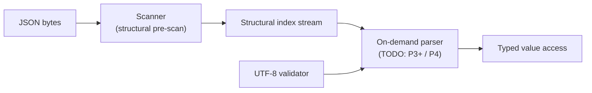

# Architecture (skeleton — full content in P6)

`ze_json` is a header-first C++23 library: everything is an `include/ze_json/**`
header (namespace `zuu`) plus a thin `src/` for out-of-line compilation units
and the wasm64 freestanding artifact. The core never touches the STL — it
ships its own type aliases (`core::size_t`, `core::Result`, `Arena`) so the
library can compile freestanding (`-nostdlib`, C-ABI) for wasm64.

## Layers

| Layer | Location | Purpose |
|---|---|---|
| core | `include/ze_json/core/` | `Result<T,E>`, `JsonErrc`, integer aliases, `NOEXCEPT`/`RESTRICT`/`EXPORT_NAME` macros, `vec128` SIMD abstraction |
| meta | `include/ze_json/meta/` | minimal type traits (`is_same`, `is_integral`, ...) replacing `<type_traits>` |
| utils | `include/ze_json/utils/` | SWAR primitives, byte repeat, alignment, arena allocation, move/forward, UTF-8 validator |
| ondemand | `include/ze_json/ondemand/` | structural scanners (`scanner8/32/64/128`), scalar reference, arena |

## Data flow

## The scanner contract

All scanner variants (`scanner8/32/64/128`) MUST reproduce
`reference_scan()` (include/ze_json/ondemand/reference.hpp) index-for-index
and error-for-error — a plain, table-free scalar function that documents the
contract in executable form:

- output = byte offsets of `[ ] { } , :` occurring outside strings
- `"` toggles string state; `\` inside a string escapes the next byte
- errors: `EmptyJson`, `InvalidJson` (unclosed string / dangling escape /
  null source), `InsufficientBuffer` (null/zero/small destination)
- UTF-8 validation and JSON grammar checks belong to later stages

The differential test (`tests/scanner_test.cpp`) is the correctness gate for
every fast path; `kJsonCharClass` (codegen table, `GenerateLookups.py`) is
itself tested against the reference character set.

## Implementation status

| Component | Status |
|---|---|
| `reference_scan` (scalar reference) | done (P1-1) |
| `scanner8` (table-driven) | done (P1-2), measured (P1-6) |
| differential test + json_checker corpus | done (P1-3, P1-4) |
| benchmarks + export sidecar | done (P1-5) |
| `scanner32/64/128` (SWAR / SIMD) | TODO (P4) — currently compiled out, see TASKS P1 notes |
| on-demand parser (typed access) | TODO |
| wasm64 C-ABI binding (`bindings/js`) | TODO (P3) |

TODO(P6): expand each section with design rationale, per-DOI technique notes
(@cite), and the wasm64 memory handshake diagram.
