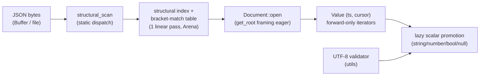
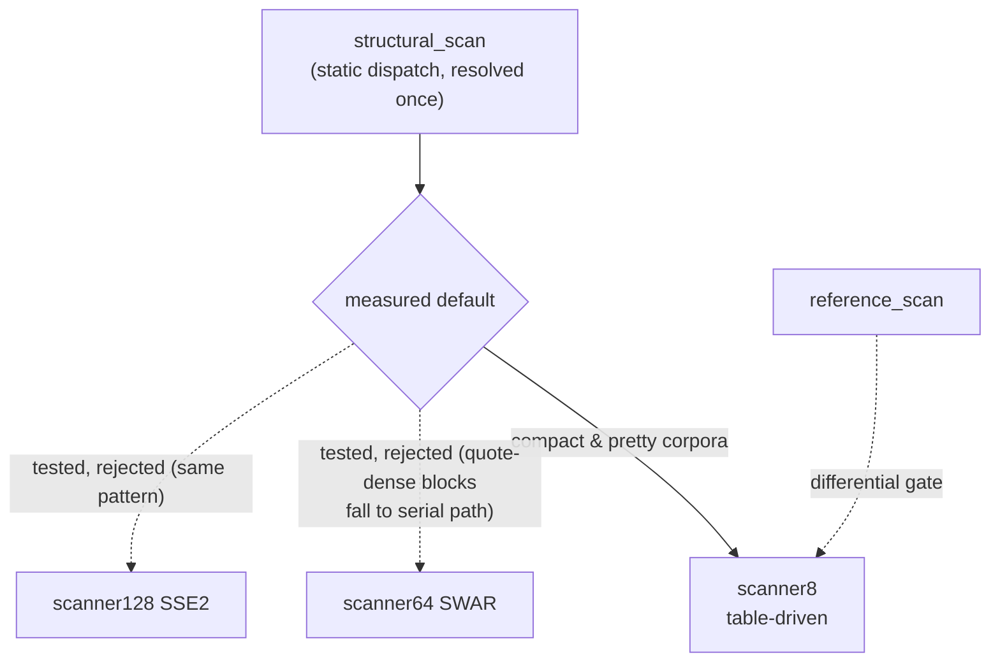
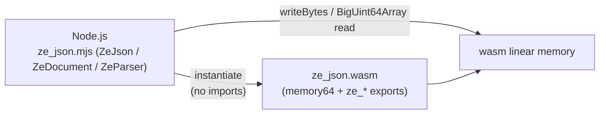

# Architecture

`ze_json` is a header-first C++23 library for **on-demand** JSON processing
(namespace `zuu`, no STL in core) with a raw wasm64 C-ABI surface for Node.js
integration. It is measured comparatively against the V8 baseline used by the
SAQ server (see `development/README.md` for the measurement workflow).

## 1. Layers

| Layer | Location | Contents |
|---|---|---|
| core | `include/ze_json/core/` | `Result<T,E>`, `JsonErrc`, integer aliases (`core::size_t`, `_u8` literals), `NOEXCEPT`/`RESTRICT`/`EXPORT_NAME`/`__LITTLE_ENDIAN__`/`__IS_64_BIT__` macros, `vec128` SIMD abstraction, generated lookup tables (`lookups.hpp`) |
| meta | `include/ze_json/meta/` | minimal type traits (`is_same`, `is_integral`, ...) replacing `<type_traits>` |
| utils | `include/ze_json/utils/` | SWAR byte-classification (`swar.hpp`), byte repeat, alignment, arena allocation, move/forward, UTF-8 validator |
| ondemand | `include/ze_json/ondemand/` | structural scanners (`scanner8`, `scanner64` SWAR, `scanner128` SSE2, `reference_scan`; `scanner32` stub on 32-bit targets), static dispatch (`structural_scan`), arena, on-demand parser (`Document`/`Value`/`ArrayIter`/`ObjectIter`, lazy scalar promotion) |
| bindings | `src/abi/cabi.cpp` (contract header `include/ze_json/abi/cabi.hpp`) | wasm64 C-ABI surface (compiled out on native; mirrored by `bindings/js/ze_json.mjs`) |
| memory | `include/ze_json/ondemand/arena.hpp` | bump `Arena` with finalizer list (no STL) |

## 2. Data flow

## 3. The scanner contract

Every scanner variant MUST reproduce `reference_scan()`
(`include/ze_json/ondemand/reference.hpp`) index-for-index and
error-for-error. The reference is deliberately table-free so a codegen bug
cannot corrupt the correctness anchor. Contract:

- output = byte offsets of `[ ] { } , :` occurring **outside** strings
- `"` toggles string state; `\` inside a string escapes the next byte
- errors (with precedence): `EmptyJson` (len 0) → `InvalidJson` (null
  source, dangling escape, unclosed string) → `InsufficientBuffer`
  (null/zero destination, capacity exhausted — `dst` then holds exactly
  `dst_cap` indices)
- UTF-8 validation and JSON grammar checks belong to later stages
- capacity overflow inside serial paths is propagated as
  `InsufficientBuffer` (regression-added in P4; previously silently ignored)

The differential gate (`tests/scanner_test.cpp`) runs fixtures, deterministic
fuzz (300+500 iterations), the full json_checker corpus (with documented RFC
8259 legacy exceptions `fail1`/`fail18`), and a 256-byte validation of the
generated `kJsonCharClass` table itself — across **all** variants.

## 4. Scanner variants & the measured decision

| Variant | Technique | Status |
|---|---|---|
| `reference_scan` | plain byte loop, char compares | correctness anchor |
| `scanner8` | table-driven (`kJsonCharClass`), 1 L1 load + 2 masked tests per byte | **dispatch default** (measured winner) |
| `scanner64` | SWAR 8-lane, three-path (fast outside / fast inside / serial) | tested, **rejected** (loses on 5/6 corpora) |
| `scanner128` | SSE2 16-lane, three-path, `cmpeq`+`movemask` | tested, **rejected** (loses on 5/6 corpora) |
| `scanner32` | 4-lane SWAR (32-bit targets) | **stub** — declared `scanner.hpp`, returns `InvalidJson` (`src/ondemand/parallel.cpp:135-147`), never measured |
| `structural_scan` | static dispatch, resolved once | production entry point |

Why the vector variants lose on compact JSON: quotes appear every ~6–15
bytes, so nearly every 8/16-byte block contains one and falls to the serial
path; the vector classification (6× SWAR eq, 12 cmpeq ops) then costs more
than `scanner8`'s single L1 table load per byte. Full tables and analysis:
`reports/P4-bottleneck-report.md` (workspace root). Future work to actually
beat the table-driven scanner requires a simdjson-style full-mask pipeline
(prefix-xor quote mask + SIMD escape-run handling), not a three-path hybrid.

## 5. The on-demand parser (as-built since P7)

`Document::open` (`src/ondemand/document.cpp`) runs `structural_scan` ONCE
per document, then builds the bracket-match table (LIFO, type-aware) in the
same linear pass — unmatched or cross-type brackets are marked `kNoBracket`
and surface as framing violations when consumed. Allocation is one arena
carve of 3 × `src_size * 8` bytes (index, match, stack upper bounds).

Access is a single forward iterator over `(token_start, cursor)` frames:

- `get_root()` eagerly frames the root (opener = first index, closer =
  last index, trailing whitespace only — the document boundary contract);
  container interiors stay unvalidated until consumed (on-demand contract).
- `Value::type()` classifies from the staged launcher byte without
  materializing; `get_string_span` / `get_double` / `get_bool` promote
  lazily through the P7-3 / P7-2 scalar paths (V8-locked semantics,
  lone-surrogate escapes pass through verbatim).
- `begin_array()` / `begin_object()` return `ArrayIter` / `ObjectIter`
  (forward-only, sticky errors); `count_elements()` walks the structural
  index without materializing children.
- Re-entry from a returned frame is O(1) in the common case and falls
  back to `first_index_at_or_after` (gallop, O(log distance)) when a
  stale cursor-less position must be re-derived (O1-8).

Correctness gates: 75 gtest `TEST`s across 6 targets (differential vs
`reference_scan`, json_checker corpus, V8-parity scalar edges, skip
semantics `SkippedSubtreeStaysUnvalidated` / `DeepSkipIsIterative`).
Benchmarks: `benchmarks/parser_benchmark.cpp` phases `BM_ParseReference`
/ `BM_ParseOpen` / `BM_ParseOnDemandWalkOnly` / `BM_ParseOnDemandFullWalk`
(full-consumption phases; a selective-access phase is future work — see
the workspace audit `docs/research/ondemand-direction-audit.md`).

@cite 10.1002_spe.3313 on-demand JSON — the single forward iterator this
layer replays token by token. @cite 10.14778_3115404.3115416 Mison — the
structural index that backs cursor re-entry without a materialized DOM.

### 5.1 JS lazy-access layer (as-built, ND-4)

`bindings/js/ze_json.mjs` adds a **JS-only** lazy-access layer on the
UNCHANGED v3 wasm surface (no ABI change, no wasm rebuild). Design contract
and numbered decisions D1–D3: workspace root
`docs/architecture/lazy-access-api.md`.

- **L1** — `ZeParser.get(key, ts, cursor)` (FIRST-wins early exit by design
  decision D1 — a documented divergence from `JSON.parse` last-wins),
  `ZeParser.at(index, ts, cursor)`, `sourceView()`, `materializeAt()` and
  the `lazy()` handle `ZeLazyValue` (`type`, `count`, `at`, `get`,
  `asString`/`asNumber`/`asBool`/`isNull`, `value`, plus the iteration
  generators `entries()`/`items()` where skipping a subtree means never
  dereferencing the yielded handle — D3, no new ABI export).
- **L2** — `ZeParser.project(shape)`: selected-subset V8-shape
  materialization in ONE forward pass. Shape grammar: `true` (take the
  value; containers fully materialize), `{$count: true}` (index-walk
  length), `{$array: itemShape}`, object shape (unlisted fields are
  stepped past, listed-but-absent keys stay ABSENT — `??` fallback parity
  with `JSON.parse`, duplicates last-wins, null-prototype target).
- Key matching is on DECODED content: a key frame's raw span is re-derived
  from the source view with a skip-pair walk (key frames carry
  `cursor == opening-quote position`, NOT the colon index — the span is
  therefore walked to its first unescaped `"`), an escape-free span is a
  raw byte compare (`TextEncoder` needle), an escaped span is decoded once
  and compared (rare path).
- Lifetime (D2): open → traverse → `close()` per document in
  `try/finally`; slot pool exhaustion (64) fails loud as `ZeParserError`;
  `binding.resetHeap()` only between batches.

Tests: `bindings/js/tests/lazy.mjs` (43 checks — T1 corpus-wide full+selective
projection parity vs `JSON.parse`, T2 duplicate/escaped/UTF-8/`__proto__`
keys, T3 lifetime + pool exhaustion, T4 skip semantics, T5 `at()`/`count()`
bounds, T6 scalar edges) plus the unchanged `npm run smoke` /
`npm run differential` gates (T7). The preliminary probe lives in
`bindings/js/benchmarks/` (labelled preliminary — measured records are ND-6
scope).

## 6. wasm64 C-ABI surface (v3)

`src/abi/cabi.cpp` compiles to real exports only on wasm targets
(`EXPORT_NAME`), and compiles out on native. Contract header:
`include/ze_json/abi/cabi.hpp` (single source of truth, mirrored by
`bindings/js/ze_json.mjs`; `kAbiVersion = 3`).

| Export group | Signature | Notes |
|---|---|---|
| `ze_abi_version` | `() -> u64` | constant `kAbiVersion` (3) |
| `ze_alloc` | `(size) -> ptr` | 16-byte aligned bump allocator from linker `__heap_base` |
| `ze_reset_heap` | `() -> void` | rewind between corpora; v3 also closes every parser slot first |
| `ze_scanner8` / `ze_reference_scan` / `ze_scanner64` / `ze_scanner128` / `ze_structural_scan` | `(src, len, dst, cap) -> u64` | scanner surface (v2): packed ok = count, error = `code << 32`; the caller picks the variant per scan (`SCANNER_MODES` in the binding) |
| `ze_parser_open` / `ze_parser_root` / `ze_parser_close` | slot + args -> u64 | parser surface (v3): `Document::open` / `get_root` / teardown on one slot |
| `ze_value_kind` / `ze_get_string` / `ze_get_number` / `ze_get_bool` / `ze_is_null` / `ze_count_elements` | `(slot, token_start, ...) -> u64` | lazy scalar access (V8-locked string/number semantics) |
| `ze_container_begin` / `ze_array_next` / `ze_object_next` / `ze_object_field` | `(slot, frame...) -> u64` | step family: ok = `(cursor << 32) \| token_start`, done = `kStepSentinel << 32` |
| `memory` | exported memory64, 64 MiB initial | `dst` entries are 64-bit `size_t` |

Parser calls operate on one slot of a static pool (`kParserSlotMax` = 64;
one Arena + one `Document` per slot). Traversal is stateless per call: the
`(cursor, token_start)` frame pair a step returns is fed back as full-width
u64 arguments, and the ABI rebuilds the real C++ iterator from it — no
framing logic is duplicated on the ABI side.

Differential guarantee for the binding: `npm run differential` compares wasm
`scanner8`, wasm `reference_scan` and a plain JS reference across the corpus
documents and json_checker cases (must agree).

## 7. Measurement architecture

Each scanner variant is benchmarked through `benchmarks/scanner_benchmark.cpp`
(google-benchmark, 5 repetitions, P0-8 corpora) exported via CMake helpers
with a metadata sidecar, then normalized into schema-v1 measurement records
(6/record-set, one per corpus) and validated. The on-demand parser is
benchmarked separately through `benchmarks/parser_benchmark.cpp` (phases:
reference / open / structural walk-only / full walk, §5). The node harness
(`scripts/node-benchmark/harness.mjs`, workspace root) runs the same corpora
for engines `v8` and `ze-wasm64` (contexts `wasm-scan`, `wasm-open`,
`wasm-walk-full`, `wasm-parse-full`) through the same record schema — see
`development/README.md`.

The parser layer above (§5) documents the as-built design; further
selective-access API work is tracked in the workspace audit
`docs/research/ondemand-direction-audit.md` (§9 proposal) and the TASKS `ND`
ledger (root workspace).
