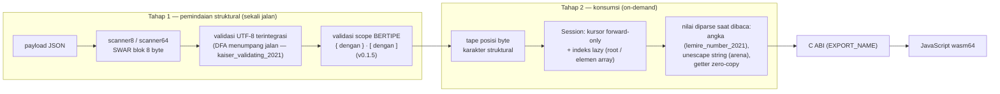

# Arsitektur: Alur E2E Dua Tahap

> Bagian dari [docs/architecture/](.) — kembali ke
> [overview.md](overview.md). Sitasi mengacu pada kunci BibTeX di
> [`references/cites.bib`](../../references/cites.bib).

## Kerangka referensi

Alur end-to-end ze_json mengikuti arsitektur dua-tahap
`langdale_parsing_2019` (Langdale & Lemire, *Parsing Gigabytes of JSON per
Second*) dengan satu penyimpangan yang disengaja: tahap-2 ze_json **tidak
mematerialisasi tape nilai penuh**, melainkan memakai konsumsi
*on-demand* per `keiser_-demand_2024` (Keiser & Lemire, *On-demand JSON:
a better way to parse documents?*) — nilai di-*parse* tepat ketika
dibaca.

## Pemetaan konsep paper → ze_json

| Konsep `langdale_parsing_2019` | Implementasi ze_json | Catatan |
|---|---|---|
| §3.1 Stage 1: *structural and pseudo-structural elements* → integer indices | `scanner8`/`scanner64` → tape posisi byte (`{ } [ ] , :` + kutip string) | scanner64 memakai SWAR blok 8 byte untuk body string |
| §3.1.5 *Character-encoding validation* | DFA UTF-8 **terintegrasi** ke jalan pemindaian (Tahap 4) — bukan pass terpisah | metode DFA dari `kaiser_validating_2021`; payload ASCII murni nyaris gratis |
| §3.2 *ensuring objects started with `{` terminated with `}`, arrays with `[` → `]`* | **Kedalaman bracket bertipe** (v0.1.5): satu counter per JENIS — underflow jenis ditolak seketika | `["mismatch"}` (fail33 json.org) kini tertangkap |
| §3.2 Stage 2: *building the tape* (value-tape penuh + scope marker + jump pointer) | **TIDAK DIADOPSI SECARA PENUH** — diganti konsumsi on-demand per `keiser_-demand_2024` | alasan di bawah |
| §3.2.1 *Number parsing* | `utils/number_parser` — parse int/double dari gap tape saat nilai dibaca | teknik tabel/lima digit per `lemire_number_2021` adalah kandidat pengganda cepat |
| §3.2.2 *String validation and normalization* | `utils/unescape` — hanya berjalan bila escape ada; hasil dialokasikan dari arena | zero-copy: string tanpa escape menunjuk payload langsung |

## Penyimpangan yang disengaja: on-demand, bukan tape nilai penuh

Paper membangun *value tape* lengkap di muka (semua angka diparse, semua
string dinormalisasi, seluruh dokumen tervalidasi gramatikal) — tepat
untuk workload yang membaca SELURUH dokumen. `keiser_-demand_2024`
menunjukkan bahwa untuk workload yang membaca SEBAGIAN field (pola API
dan hot loop nyata), memperlambat tahap-2 menjadi konsumsi malas lebih
unggul: biaya di muka hanya tahap-1, nilai dibayar sesuai yang dipakai.

Konsekuensi pada ze_json:

- Scanner = validator **struktural** saja; validasi gramatikal nilai
  (kutip kunci, sintaks angka, escape legal) bukan ranah tahap-1 —
  dikunci oleh `tests/JSON_checker_test` (29 divergensi terdokumentasi).
- Akses acak ditanggung indeks lazy (root: `23a12ee`; elemen array:
  `8e0f3e3`) dan kueri path yang me-rewind.
- Arena bump-allocator membuat siklus dokumen berikutnya tanpa alokasi.

## Validasi scope bertipe (v0.1.5)

Hingga v0.1.4 kedalaman bracket memakai SATU counter agregat —
`["mismatch"}` (tipe penutup tak cocok, jumlah seimbang) lolos. v0.1.5
memisahkan counter per jenis (`{`/`}` dan `[`/`]`): penutupan jenis yang
salah kini ditolak seketika sebagai *underflow jenis*, sesuai semantik
paper §3.2.

**Batas terdokumentasi**: saling-silang seperti `[{]}` (jumlah per jenis
seimbang, urutan salah) tetap lolos — dua counter tak melacak URUTAN;
paper menangkapnya lewat stack scope di tahap-2. Status: batas desain
yang dikunci asersi `scanner_test` (kedua varian wajib setuju) —
diangkat kelak bila stack scope tahap-2 diadopsi.

Guard performa: delta kode berjalan hanya pada karakter struktural;
pengukuran lintas-run berada DI BAWAH lantai noise rig (±20–25%) —
artefak `tahap5_typedepth_guard*.json`.

## Sitasi

| Kunci BibTeX (`references/cites.bib`) | Dipakai untuk |
|---|---|
| `langdale_parsing_2019` | kerangka dua tahap; format tape indices; validasi scope |
| `keiser_-demand_2024` | penyimpangan tahap-2 on-demand (desain inti ze_json) |
| `kaiser_validating_2021` | DFA validasi UTF-8 terintegrasi |
| `lemire_number_2021` | parsing angka (referensi teknik) |
| `jiang_scalable_2020` | indeks struktural — kerabat konsep indeks lazy ze_json |

## Berkas terkait

- [scanner.md](scanner.md) — detail tahap-1 + kontrak galat
- [session.md](session.md) — detail tahap-2 on-demand (kursor, indeks lazy)
- [optimizations.md](optimizations.md) — bukti benchmark tiap tahap optimasi
