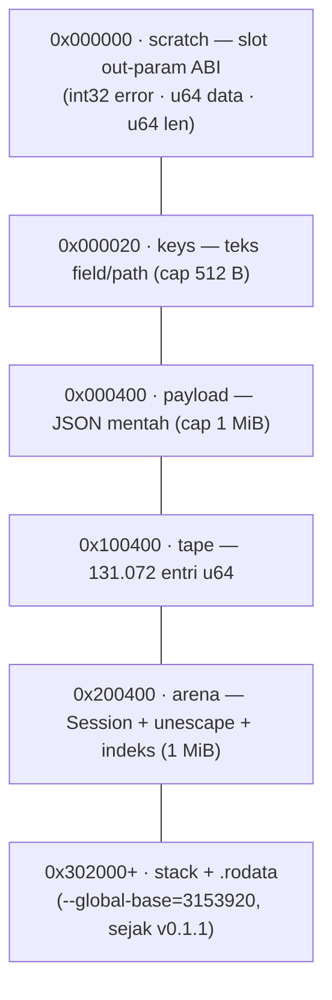

# Arsitektur: Binding JavaScript (Raw WebAssembly memory64)

> Bagian dari [docs/architecture/](.) — kembali ke
> [overview.md](overview.md).

## Tanpa Emscripten, tanpa glue runtime

`js/ze_json.mjs` meng-*instantiate* `ze_json_core.wasm` secara langsung
(`WebAssembly.Module` + `Memory { initial, index: "i64" }`). Setiap fungsi
publik C++ tereksport apa adanya lewat `EXPORT_NAME`; binding hanya:

- menyiapkan **region memori tetap** (lihat diagram),
- menulis payload/key ke region,
- memindahkan argumen & hasil lintas ABI (pointer/size `BigInt`).

Konsekuensi ABI 64-bit: semua pointer dan `size_t` tampil sebagai `BigInt`
di sisi JS; angka 64-bit dari `get_int` juga `BigInt` (dikonversi
`Number` oleh `intAt`).

## Layout memori tetap



| Kontrak | Nilai | Catatan |
|---|---|---|
| Payload maksimum | **1 MiB** | `openDocument` menolak lebih |
| Root dokumen | wajib **object** | kontrak `Session` |
| Entri tape | 131.072 (`PAYLOAD_CAP/8`) | JSON realistis ~0,3–0,5 entri/byte; payload sintetis ber-entri padat bisa kena `INSUFFICIENT_BUFFER` lebih dini |
| Region keys | 512 B | path/kunci ditulis ulang per kueri |
| Arena | 1 MiB | di-reset per `openDocument` / `close()` |

Sejak v0.1.1 stack + `.rodata` dipindah **di atas** seluruh region tetap —
di v0.1.0 payload >63,9 KB menimpa `.rodata` dan gagal `INVALID_UTF8`
palsu (bug layout, sudah tertutup regresi payload >64 KiB di smoke test).

## Kontrak API JS (ringkas — detail lengkap di [api.md](../api.md))

- **`openDocument(text)`** — scan + tape + `Session` sekali jalan; melempar
  `Error` berstatus ABI bila payload rusak (`scan gagal: STATUS=…`).
  Payload dikonversi UTF-8 **langsung ke region memori wasm** lewat
  `TextEncoder.encodeInto` (satu salinan, tanpa buffer sementara —
  bukti ×4–×24 pada ASCII di `js_copy_*.json`).
- **Path query tidak melempar** — mengembalikan `{ status, value }` /
  `{ status, type }` (`OK`, `NOT_FOUND`, `TYPE_MISMATCH`, `INVALID_PATH`).
- **Getter per-field menolak tipe salah** (sejak v0.1.2): `asString`/
  `asInt`/`asDouble`/`asBoolean` melempar `Error` berstatus
  `TYPE_MISMATCH` bila kursor tidak sedang memegang nilai dengan tipe
  yang diminta — sebelumnya `asString` pada kursor habis melempar
  `RangeError` kabur dan getter numerik memulangkan nilai sampah.
- **Traversal array dua pola** — counted (`arraySize()` lalu loop
  `arrayNext()`) atau streaming (langsung loop `arrayNext()`, hasil
  identik, satu lintasan).
- **String zero-copy** — `asString()`/`stringAt()` menunjuk langsung ke
  payload/arena; **wajib dikonsumsi sebelum `resetArena`/`openDocument`
  berikutnya**.

## Paket npm

`@zuudevs/ze-json` — berkas terpublikasi hanya `ze_json.mjs` +
`ze_json_core.wasm` (disalin oleh skrip `prepack` dari hasil build CI,
lihat `.github/workflows/npm-publish.yml`). Rilis via tag `v*`:
CI membangun wasm64 → menjalankan smoke test → `npm publish`.

```bash
cd js
npm run build:wasm   # cmake --preset wasm64-release && build
npm test             # 40 asersi smoke lintas ABI
```

## Berkas terkait

- Binding: [`js/ze_json.mjs`](../../js/ze_json.mjs)
- Smoke: [`js/test/main.mjs`](../../js/test/main.mjs)
- README paket: [`js/README.md`](../../js/README.md)
- Contoh: [`examples/js/example.mjs`](../../examples/js/example.mjs)
