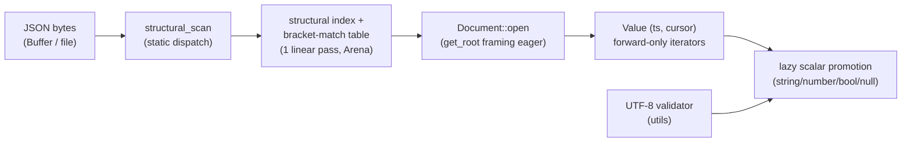

# Layers and data flow

## 1. Layers

| Layer | Location | Contents |
|---|---|---|
| core | `include/ze_json/core/` | `Result<T,E>`, `JsonErrc`, integer aliases (`core::size_t`, `_u8` literals), `NOEXCEPT`/`RESTRICT`/`EXPORT_NAME`/`__LITTLE_ENDIAN__`/`__IS_64_BIT__` macros, `vec128` SIMD abstraction, generated lookup tables (`lookups.hpp`) |
| meta | `include/ze_json/meta/` | minimal type traits (`is_same`, `is_integral`, ...) replacing `<type_traits>` |
| utils | `include/ze_json/utils/` | SWAR byte-classification (`swar.hpp`), byte repeat, alignment, arena allocation, move/forward, UTF-8 validator |
| ondemand | `include/ze_json/ondemand/` | structural scanners (`scanner8`, `scanner64` SWAR, `scanner128` SSE2, `reference_scan`; `scanner32` stub on 32-bit targets), static dispatch (`structural_scan`), arena, on-demand parser (`Document`/`Value`/`ArrayIter`/`ObjectIter`, lazy scalar promotion) |
| bindings | `src/abi/cabi.cpp` (contract header `include/ze_json/abi/cabi.hpp`) | wasm64 C-ABI surface (compiled out on native; mirrored by `bindings/js/ze_json.mjs`) |
| memory | `include/ze_json/ondemand/arena.hpp` | bump `Arena` with finalizer list (no STL) |

## 2. Data flow

Related: [`scanner-contract.md`](scanner-contract.md),
[`ondemand-parser.md`](ondemand-parser.md), [`wasm-abi.md`](wasm-abi.md).
