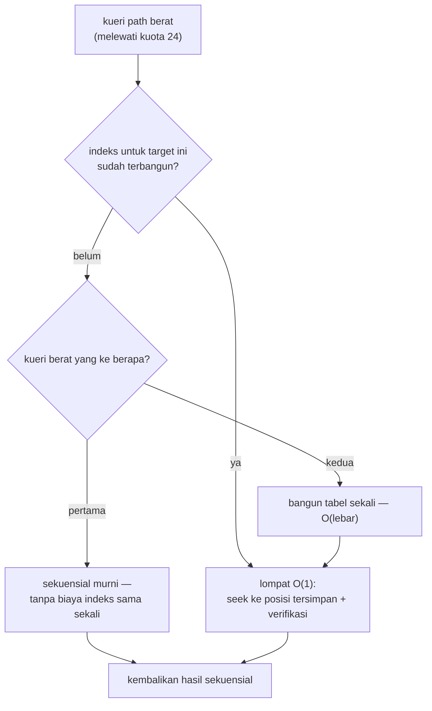

# Arsitektur: Optimisasi Bottleneck — 4 Tahap

> Bagian dari [docs/architecture/](.) — kembali ke
> [overview.md](overview.md).

## Metodologi (tahan noise)

Pengukuran performa di mesin pengembang ini hanya sah dengan dua disiplin:

1. **Perbandingan dalam satu proses (interleaved)** untuk pipeline — jam
   antar-proses bergetar 15–45%. Replika jalur lama (mis. pass validator
   terpisah) berjalan bersebelahan dengan jalur baru di run yang sama.
2. **Rasio dalam-run** untuk kueri berulang lintas iterasi — satu session
   dipakai lintas iterasi, rasio last/first yang dibandingkan.

Aturan lengkap, konvensi tooling, dan resep menambah benchmark ada di
[docs/development/benchmarking.md](../development/benchmarking.md).
Semua artefak before/after ter-commit di
[`out/results/benchmark/`](../../out/results/benchmark/).

## Empat tahap

| Tahap | Commit | Bukti utama (before → after) |
|---|---|---|
| **1** · scanner64 di `create_session` | `e408674` | E2E pipeline **×1,14–1,21** pada 512/64 KiB (satu proses, stabil dua run); scanner-only ×1,159 |
| **2** · indeks root lazy | `23a12ee` | kunci jauh objek lebar menjadi **O(1)**: 1024 field — tengah **6589 → 34 ns** (×195), akhir **12995 → 36 ns** (×366); objek ≤24 field tak tersentuh |
| **3** · streaming `array_next` | `47e9cb7` | pola baca satu-lintasan kini **berfungsi** (dulu `array_next` tanpa `array_size` selalu 0 — benchmark streaming skip semua); 1024 elemen **~0,83×** waktu pola counted; counted tak berubah |
| **4** · validasi UTF-8 terintegrasi + indeks elemen array | `8e0f3e3` | payload UTF-8 padat 64 KiB **−42,7%** E2E (DFA tak dijalankan dua kali; interleaved; ASCII tanpa regresi ~2%); path `items[K]` jauh: 1024 elemen — tengah **2594 → ~65 ns** (×40), akhir **5289 → ~71 ns** (×75) |

## Tahap-6 · probe span hybrid — eksperimen NEGATIF, di-revert

Hipotesis A1 (PR #4): biaya marginal per-byte span non-string `scanner64`
terkonfirmasi **95–96% dari loop byte** (slope replika in-run, §5b notebook)
— tetapi adopsinya ke `scanner64` seutuhnya (PR #5) GAGAL terukur dan
dikembalikan ke loop byte v0.1.6 (`4718def`), mengikuti preseden goto.

Dua varian, keduanya lolos 8 suite gtest, keduanya kalah vs replika
`scanner64` v0.1.6 beku (`replica_span_prehybrid.hpp`) di pasangan
terhimpit dataset nyata (`BM_SpanReal_*`, rasio prehybrid/hybrid; <1 =
regresi):

| dataset | V1 inline (r1/r2) | V2 helper `noinline` |
|---|---|---|
| github_events | 0,72 / 0,75 | 0,92 |
| jeopardy | 0,79 / 0,79 | 0,79 |
| canada | 0,86 / 0,77 | 0,91 |
| citm_catalog | 1,00 / 0,83 | 0,56 |
| twitter | 0,92 / 0,70 | 0,45 |
| mesh | 0,93 / 0,91 | 0,81 |
| update_center | — / 0,99 | 0,98 |

Akar masalah (kuanti, `samples/`): span non-string nyata pendek (2–6 byte)
sehingga gate adaptif nyaris tak pernah menyala (blok 8-byte lolos predikat
0–6,5% kecuali canada 37,7% / citm 46,5% — dan di sana biaya pemeriksaan
predikat pada blok gagal menelan lompatannya). V2 membuktikan komponen
codegen: loop byte pulih (github 0,72→0,92) begitu probe keluar dari badan
loop, tetapi call+gate per span menenggelamkan regime ber-span padat
(twitter 0,70→0,45). Selain itu ada bug kecil proses: `update_center` r1
bernilai 0.0 karena embedded filename tanpa tanda hubung — diperbaiki
dengan bentuk makro `REGISTER_SPAN_REAL_PAIR(FAMILY, FILE_NAME, CAPACITY)`.
Replika span_iso tetap menang di payload sintetis karena bekerja
span-only (tanpa tape/bracket/quote-SWAR).

**Pelajaran**: harness isolasi yang positif TIDAK cukup — adopsi harus
diukur pasangan-terhimpit sebelum masuk `src/`; dan biaya *per keputusan*
(probe, branch, call) yang tidak mampu dihindari per-token memenangkan
segala penghematan per-byte di data nyata. Tautan bukti:
`spanreal_pair_*`, `scanner_span_hybrid_interleaved_*`,
`spaniso_hybrid_interleaved_*` + notebook §5/§5b.

## Tahap-7 · validator gramatikal tape-walk (C2) — eksperimen NEGATIF, benchmark-only

Hipotesis: gramatika dapat divalidasi "gratis" dari data yang sudah
dihasilkan scanner64 — pass O(token) kedua men-walk entri tape, tanpa
memindai ulang payload. Replika beku
`benchmarks/session_benchmark/replica_grammar_tapewalk.hpp`
(mesin status 10-state + stack-bit, gerbang korpus json.org 33 fail
sesuai target) diukur pasangan terhimpit `BM_GRAM_Base_*` vs
`BM_GRAM_Tapewalk_*` (commit `97c053d`).

Hasil: overhead **+90% s.d. +201%** terhadap `create_session` di
SEMUA 8 dataset (tabel lengkap di
[grammar-validation.md](grammar-validation.md) §Hasil pengukuran).
Dekomposisi kuadrat-terkecil (R² = 1,0000) atas karakterisasi tape
`samples/`:

```
overhead_ns ≈ 7,14 × entri_tape + 0,64 × byte_ws + 1,44 × byte_angka
```

Biaya didominasi **α ≈ 7,1 ns per entri tape** (dispatch state machine),
bukan scan gap: `update_center` (+135%) nyaris tanpa byte-gap sama
sekali; `canada` dikunci β_num 1,44 ns/B (gap 1,98 MB angka). AMD uProf
(`assess_ext`) mengonfirmasi: klaster validator ber-CPI ~0,55 dengan
mispredict cabang hanya 0,45–1,4% — biaya adalah jumlah instruksi
skalar per entri, bukan denda prediksi.

Floor proyeksi (DFA sempurna α→2,5 ns + SWAR ws β_ws→0,15 ns, β_num
tetap) tetap menyisakan overhead **35–119%** base: gerbang ±5–10%
menuntut < 0,5 ns/entri — di bawah biaya satu lompatan kondisional.
**Pass kedua di atas tape tidak pernah bisa gratis.**

**Pelajaran**: data gratis (tape) TIDAK berarti pemrosesan kedua gratis —
biaya per-entri O(token) tak tersubsidi oleh apa pun yang sudah dibayar
scanner. Validasi gramatikal penuh hanya realistis via fusi ke
Stage-1 (preseden goto: −50% throughput — berisiko) atau tetap lazy di
Stage-2 (kebijakan saat ini). Tautan bukti:
`grammar_walk_interleaved_97c053d.json`, aturan notebook
`gram_base_vs_tapewalk`, `out/results/profiling/amduprof_tahap7_*.csv`.

## Kebijakan indeks lazy (dipakai tahap 2 & 4)

Indeks TIDAK dibangun di `create_session` (itu akan membebani pipeline dan
kasus sekali-baca). Kebijakannya adaptif dan identik untuk indeks root
(hash-table di arena, verifikasi byte-exact) maupun indeks elemen array
(tabel dense posisi kursor):



Jaminan semantik: hasil & status kueri identik di semua mode. Kunci
ber-escape dikecualikan dari indeks root (pencocokan sekuensial
membandingkan hasil unescape — teks mentah tidak ekuivalen) dan miss indeks
jatuh ke sekuensial penuh; duplikat kunci mempertahankan kemunculan
pertama; indeks elemen array terikat identitas array (tape idx `'['`) dan
dibangun ulang bila pindah target (blok arena dipakai ulang selama kapasitas
cukup).

## Sapuan ukuran JS: JSON.parse (V8) vs ze_json

`js/benchmark/sizes.mjs` — payload sintetis deterministik, satu proses,
isolasi metrik (payload & warm-up di luar pengukuran, SINK anti-DCE,
pasangan bersebelahan minTime identik). µs/op — **kecil = cepat**.
(angka di bawah PASCA optimisasi salin payload `encodeInto` — lihat
subbab berikutnya; artefak before di `js_sizes_ec34ee5.*`, after di
`js_sizes_073fc0f.*`)

| ukuran | JSON.parse | ze scan | baca 2 field: JSON | ze | iterasi penuh: JSON | ze |
|---|---|---|---|---|---|---|
| 95 B | 1,0 | **0,6** | **1,1** | 2,4 | **1,2** | 2,3 |
| 268 B | 3,4 | **1,1** | **2,6** | 2,9 | **3,2** | 9,2 |
| 1 KiB | 11,3 | **3,1** | 9,4 | **5,7** | **8,7** | 36,5 |
| 4 KiB | 34,7 | **9,7** | 31,4 | **11,3** | **31,3** | 108,3 |
| 16 KiB | 127,6 | **36,8** | 118,2 | **38,7** | **137,8** | 561,5 |
| 64 KiB | 714,5 | **184,7** | 529,9 | **163,4** | **534,0** | 1851,4 |
| 256 KiB | 2026,7 | **595,8** | 2340,0 | **599,3** | **2431,7** | 6722,0 |

Pembacaan hasil:

- **Scan murni menang di semua ukuran teruji** — termasuk rezim mungil
  (95 B: 0,57 vs 1,02 µs) sejak salin payload memakai `encodeInto`.
- **Pola "baca 2 field"**: rezim mungil (≲300 B) masih kalah — dua path
  query per op membawa overhead panggilan wasm; menang mulai **1 KiB**;
  pada 256 KiB **~3,9× lebih cepat**.
- **Konsumsi penuh** (baca SEMUA item): `JSON.parse` menang di semua
  ukuran — ze_json parser on-demand; materialisasi penuh lewat path
  query per-item bukan medannya.

## Optimisasi lanjutan: salin payload `encodeInto` (binding JS)

Di luar empat tahap C++, pengukuran sapuan mengungkap salinan payload JS
mendominasi E2E: `writeText` dulu memakai `TextEncoder.encode()`
(mengalokasi `Uint8Array` sementara) lalu `u8.set()` ke memori wasm —
**dua salinan + satu alokasi per dokumen**. `TextEncoder.encodeInto()`
menulis langsung ke view memori wasm (V8 punya jalur cepat khusus untuk
tujuan wasm memory) — satu salinan, nol alokasi sementara.

Bukti interleaved satu proses (`js/benchmark/copy.mjs` → artefak
`js_copy_*.json`; kedua strategi memuat biaya view + byte pengaman + cek
kontrak):

| teks | encode+set | encodeInto | rasio |
|---|---:|---:|---:|
| 11 B (skala key) | 0,84 µs | 0,20 µs | **×0,24** |
| 4 KiB | 4,68 µs | 0,28 µs | **×0,06** |
| 64 KiB | 53,55 µs | 2,25 µs | **×0,04** (24× lebih cepat) |
| 256 KiB | 147,74 µs | 11,43 µs | **×0,08** |
| 64 KiB UTF-8 padat | 239,08 µs | 174,07 µs | ×0,73 (encoding multibyte dominan) |

Efek E2E (sizes.mjs): ze scan 256 KiB **944 → 596 µs**, throughput
**~280 → ~440 MB/s**; titik impas scan murni turun ke **di bawah 95 B**
(dahulu 268 B); pola baca 2 field di 256 KiB naik ke **~3,9×** (dahulu
~2,7×). Regresi: smoke JS 40/40 (termasuk payload 66 KB ber-UTF-8 yang
kini lewat jalur `encodeInto`).

## Regresi menjaga tiap tahap

Setiap tahap diiringi uji regresi: **51 test native per preset** (8 grup —
scanner 10, document 2, number 3, object 5, session 4, array 7, path 14)
dan **40 asersi smoke JS**. Tahap 2: +4 aseri path; tahap 3: +4 aseri
array; tahap 4: +2 scanner (sekuens multibyte terbelah batas blok) +4 path
(indeks elemen array). Angka di pesan commit v0.1.2 sempat tertulis 53;
hitungan aktual 45 per preset — changelog memakai angka yang benar.

## Berkas terkait

- Benchmark native: [`benchmarks/session_benchmark/`](../../benchmarks/session_benchmark/)
- Benchmark JS: [`js/benchmark/sizes.mjs`](../../js/benchmark/sizes.mjs),
  [`js/benchmark/parse.mjs`](../../js/benchmark/parse.mjs)
- Artefak: [`out/results/benchmark/`](../../out/results/benchmark/)
  (mis. `arrayread_before.json`, `rootwide_pathquery_*`,
  `tahap4_interleaved.json`, `js_sizes_*.md`)
