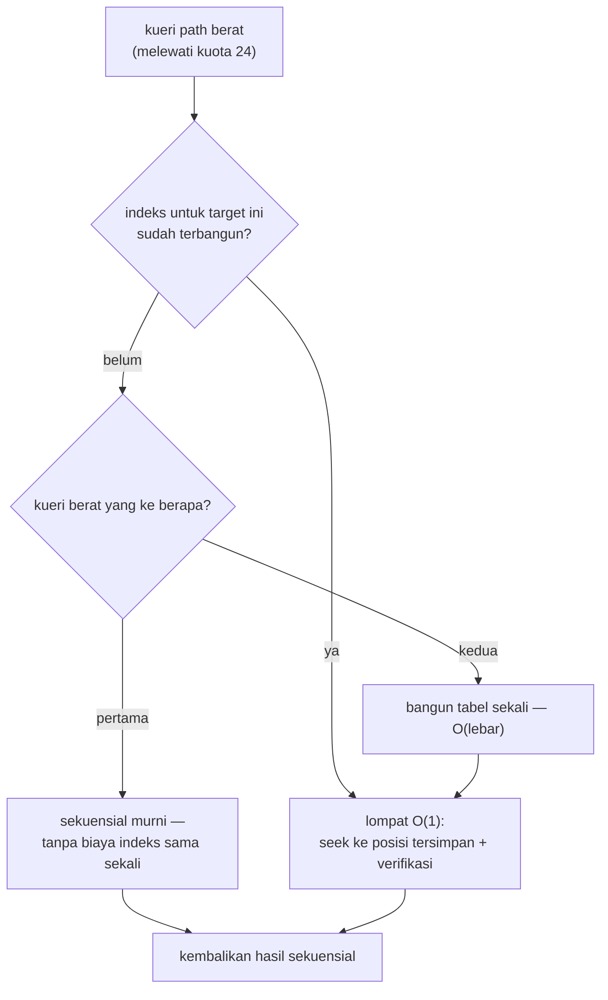

# Arsitektur: Optimisasi Bottleneck — 4 Tahap

> Bagian dari [docs/architecture/](.) — kembali ke
> [overview.md](overview.md).

## Metodologi (tahan noise)

Pengukuran performa di mesin pengembang ini hanya sah dengan dua disiplin:

1. **Perbandingan dalam satu proses (interleaved)** untuk pipeline — jam
   antar-proses bergetar 15–45%. Replika jalur lama (mis. pass validator
   terpisah) berjalan bersebelahan dengan jalur baru di run yang sama.
2. **Rasio dalam-run** untuk kueri berulang lintas iterasi — satu session
   dipakai lintas iterasi, rasio last/first yang dibandingkan.

Aturan lengkap, konvensi tooling, dan resep menambah benchmark ada di
[docs/development/benchmarking.md](../development/benchmarking.md).
Semua artefak before/after ter-commit di
[`out/results/benchmark/`](../../out/results/benchmark/).

## Empat tahap

| Tahap | Commit | Bukti utama (before → after) |
|---|---|---|
| **1** · scanner64 di `create_session` | `e408674` | E2E pipeline **×1,14–1,21** pada 512/64 KiB (satu proses, stabil dua run); scanner-only ×1,159 |
| **2** · indeks root lazy | `23a12ee` | kunci jauh objek lebar menjadi **O(1)**: 1024 field — tengah **6589 → 34 ns** (×195), akhir **12995 → 36 ns** (×366); objek ≤24 field tak tersentuh |
| **3** · streaming `array_next` | `47e9cb7` | pola baca satu-lintasan kini **berfungsi** (dulu `array_next` tanpa `array_size` selalu 0 — benchmark streaming skip semua); 1024 elemen **~0,83×** waktu pola counted; counted tak berubah |
| **4** · validasi UTF-8 terintegrasi + indeks elemen array | `8e0f3e3` | payload UTF-8 padat 64 KiB **−42,7%** E2E (DFA tak dijalankan dua kali; interleaved; ASCII tanpa regresi ~2%); path `items[K]` jauh: 1024 elemen — tengah **2594 → ~65 ns** (×40), akhir **5289 → ~71 ns** (×75) |

## Kebijakan indeks lazy (dipakai tahap 2 & 4)

Indeks TIDAK dibangun di `create_session` (itu akan membebani pipeline dan
kasus sekali-baca). Kebijakannya adaptif dan identik untuk indeks root
(hash-table di arena, verifikasi byte-exact) maupun indeks elemen array
(tabel dense posisi kursor):

Jaminan semantik: hasil & status kueri identik di semua mode. Kunci
ber-escape dikecualikan dari indeks root (pencocokan sekuensial
membandingkan hasil unescape — teks mentah tidak ekuivalen) dan miss indeks
jatuh ke sekuensial penuh; duplikat kunci mempertahankan kemunculan
pertama; indeks elemen array terikat identitas array (tape idx `'['`) dan
dibangun ulang bila pindah target (blok arena dipakai ulang selama kapasitas
cukup).

## Sapuan ukuran JS: JSON.parse (V8) vs ze_json

`js/benchmark/sizes.mjs` — payload sintetis deterministik, satu proses,
isolasi metrik (payload & warm-up di luar pengukuran, SINK anti-DCE,
pasangan bersebelahan minTime identik). µs/op — **kecil = cepat**:

| ukuran | JSON.parse | ze scan | baca 2 field: JSON | ze | iterasi penuh: JSON | ze |
|---|---|---|---|---|---|---|
| 95 B | **1,7** | 2,4 | **1,6** | 6,9 | **1,6** | 5,7 |
| 268 B | 3,8 | **2,9** | 3,6 | 8,2 | **4,3** | 21,1 |
| 1 KiB | 20,1 | **7,9** | 13,2 | **12,2** | **15,0** | 88,9 |
| 4 KiB | 38,6 | **14,2** | 31,9 | **16,7** | **36,4** | 204,8 |
| 16 KiB | 141,8 | **48,7** | 148,5 | **69,8** | **168,0** | 1217 |
| 64 KiB | 726,1 | **251,2** | 592,5 | **257,2** | **632,9** | 3956 |
| 256 KiB | 2640,4 | **944,4** | 2574,0 | **961,8** | **2703,1** | 15606 |

Pembacaan hasil:

- **Rezim mungil (≲300 B) ze_json kalah** — overhead tetap wasm (panggilan
  ABI + salin payload ke region) belum teramortisasi; ini kekalahan
  struktural, bukan bug.
- **Titik impas**: scan murni menang mulai **268 B**; pola "parse + baca 2
  field" menang mulai **1 KiB**; pada 256 KiB **~2,7× lebih cepat**.
- **Konsumsi penuh** (baca SEMUA item): `JSON.parse` menang di semua ukuran
  — ze_json parser on-demand; materialisasi penuh lewat path query per-item
  bukan medannya.

## Regresi menjaga tiap tahap

Setiap tahap diiringi uji regresi: **45 test native per preset** (7 grup —
scanner 10, document 2, number 3, object 5, session 4, array 7, path 14)
dan **40 asersi smoke JS**. Tahap 2: +4 aseri path; tahap 3: +4 aseri
array; tahap 4: +2 scanner (sekuens multibyte terbelah batas blok) +4 path
(indeks elemen array). Angka di pesan commit v0.1.2 sempat tertulis 53;
hitungan aktual 45 per preset — changelog memakai angka yang benar.

## Berkas terkait

- Benchmark native: [`benchmarks/session_benchmark/`](../../benchmarks/session_benchmark/)
- Benchmark JS: [`js/benchmark/sizes.mjs`](../../js/benchmark/sizes.mjs),
  [`js/benchmark/parse.mjs`](../../js/benchmark/parse.mjs)
- Artefak: [`out/results/benchmark/`](../../out/results/benchmark/)
  (mis. `arrayread_before.json`, `rootwide_pathquery_*`,
  `tahap4_interleaved.json`, `js_sizes_*.md`)
