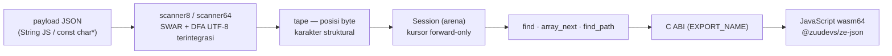

# Arsitektur: Gambaran Umum

> Dokumen ini adalah bagian dari [`docs/`](../) — lihat juga
> [Referensi API](../api.md) · [Changelog](../changelog.md) ·
> [README utama](../../README.md).

## Dua ide dasar

`ze_json` dibangun di atas dua ide sederhana:

1. **Discan sekali, dibaca on-demand.** Scanner SWAR memvalidasi seluruh
   payload (UTF-8, string, tanda kurung) dan **merekam tape** — daftar posisi
   byte setiap karakter struktural — *tanpa membangun tree*. Nilai hanya
   di-*parse* tepat ketika dibaca, dan string **tidak disalin**: pembacaan
   menunjuk langsung ke memori payload (zero-copy); unescape hanya berjalan
   bila benar-benar diperlukan dan hasilnya dialokasikan dari arena.
2. **Semua alokasi dari arena.** `Session` + string hasil unescape + indeks
   pencarian lazy hidup dalam satu arena bump-allocator; siklus dokumen
   berikutnya hanya butuh `reset_arena` — hot loop **tanpa alokasi** dan
   tanpa fragmentasi.

## Pipeline



Karakteristik penting dari pipeline ini:

- **Scanner tidak membangun tree** — hanya array bilangan (`tape`). Hal ini
  membuat biaya di muka proporsional terhadap ukuran payload, bukan jumlah
  nilai yang akhirnya dipakai.
- **Kursor forward-only**: satu `Session` memegang SATU kursor di atas tape;
  nilai dibaca dengan menelusuri posisi struktural (detail di
  [session.md](session.md)).
- **Binding JS tanpa glue**: setiap fungsi publik tereksport langsung sebagai
  simbol wasm (detail di [js-binding.md](js-binding.md)).

## Struktur repository

```
ze_json/
├── include/ze_json/        API publik C++, on-demand layer, scanner, memory
│   ├── ze_json.hpp         Session + C ABI (EXPORT_NAME) + enum Status/ValueType
│   ├── scanner/scanner.hpp scanner8 / scanner64 (SWAR, validasi UTF-8 terintegrasi)
│   ├── ondemand/           document.hpp, json_object.hpp, json_value.hpp,
│   │                       json_iterator.hpp, json_array.hpp
│   ├── core/macros.hpp     makro NOEXCEPT / EXPORT_NAME / RESTRICT
│   └── memory/arena.hpp    bump allocator
├── src/                    implementasi (scanner, ondemand, C ABI, compiler_rt stub)
├── tests/                  8 grup uji google-test (1 kelompok = 1 folder):
│                           scanner, document, object, number, session,
│                           array, path, JSON_checker (reference json.org)
├── benchmarks/             3 grup google-benchmark (1 kelompok = 1 folder):
│                           scanner (samples), parser (Document), session (C ABI)
├── js/                     PUBLIC API JavaScript (@zuudevs/ze-json)
│   ├── ze_json.mjs         binding wasm64 + konstanta layout + kelas ZeJson/Doc
│   ├── benchmark/          parse.mjs (korpus), sizes.mjs (sapuan ukuran), copy.mjs
│   └── test/main.mjs       40 asersi smoke lintas ABI
├── docs/                   dokumentasi modular (berkas ini)
├── examples/js/example.mjs demo end-to-end di JS
├── scripts/                agregator metrik (test_metrics.js, benchmark_metrics.js)
│                           + analyze_result/ (notebook analisis artefak)
│                           + invoke_JSON_checker/ (pengunduh korpus reference)
├── cmake/                  preset CMake (C++23, LLVM/clang, helper vcpkg)
├── out/results/            artefak metrik ter-commit (JSON + Markdown)
└── samples/                SUBMODULE — korpus simdjson ~61 MB (gitlink;
                            https://github.com/zuudevs/ze_json_sample)
```

## Prinsip desain

| Prinsip | Konsekuensi |
|---|---|
| On-demand, bukan materialisasi | unggul saat hanya sebagian field yang dibaca; kalah saat SELURU dokumen dikonsumsi (diukur jujur di [optimizations.md](optimizations.md)) |
| Satu kursor forward-only per Session | memori kursor O(1); akses acak lewat path query yang me-rewind dari root |
| Zero-copy | string menunjuk langsung ke payload; hanya unescape yang mengalokasikan (arena) |
| Region memori tetap (binding JS) | tanpa churn heap JS; tapi payload ≤ 1 MiB dan root wajib object |
| Bukti, bukan klaim | setiap optimasi wajib punya benchmark before/after ter-commit |

## Batasan yang dikenal

- **Kunci exact-byte**: pencarian `find_field`/path membandingkan byte mentah
  payload — kunci dengan escape (`"\u0061"`) tidak cocok dengan path `"a"`
  (terdokumentasi di header). Kunci ber-escape pun dikecualikan dari indeks
  lazy dan dijawab fallback sekuensial agar semantik tidak berubah.
- **1 Session = 1 dokumen ber-root object**: array root perlu dibungkus
  object atau dibaca via `Document` langsung.
- **Kursor forward-only**: `find_field` kumulatif hanya maju; untuk akses
  acak gunakan path query (tiap kueri me-rewind dari root).
- **Payload binding JS ≤ 1 MiB** dan **region tape 131.072 entri** — payload
  sintetis ber-entri padat bisa kena `INSUFFICIENT_BUFFER` sebelum 1 MiB.
- **Kunci yang ditulis ke region harus ditulis ulang setelah `reset_arena`**
  — region payload tetap, tapi Session baru harus di-*create* ulang.

## Berkas terkait

- [e2e-flow.md](e2e-flow.md) — alur E2E dua tahap (referensi paper + sitasi)
- [scanner.md](scanner.md) — pemindaian, SWAR, format tape, validasi UTF-8
- [session.md](session.md) — kursor, traversal array, path query
- [optimizations.md](optimizations.md) — 4 tahap optimasi + bukti benchmark
- [js-binding.md](js-binding.md) — layout memori wasm64 & kontrak binding
- [../api.md](../api.md) — referensi Status, C ABI, C++, dan JavaScript
- [../development/](../development/workflow.md) — dokumentasi pengembangan:
  workflow, konvensi penamaan, testing, benchmarking
