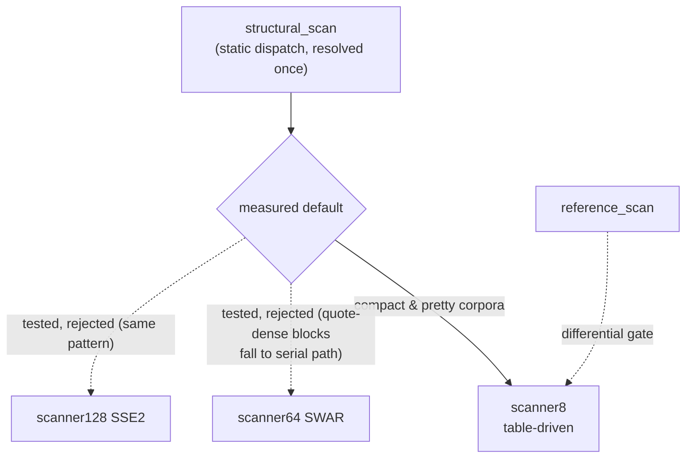

# Scanner variants and the measured dispatch decision

| Variant | Technique | Status |
|---|---|---|
| `reference_scan` | plain byte loop, char compares | correctness anchor |
| `scanner8` | table-driven (`kJsonCharClass`), 1 L1 load + 2 masked tests per byte | **dispatch default** (measured winner) |
| `scanner64` | SWAR 8-lane, three-path (fast outside / fast inside / serial) | tested, **rejected** (loses on 5/6 corpora) |
| `scanner128` | SSE2 16-lane, three-path, `cmpeq`+`movemask` | tested, **rejected** (loses on 5/6 corpora) |
| `scanner32` | 4-lane SWAR (32-bit targets) | **stub** — declared `scanner.hpp`, returns `InvalidJson` (`src/ondemand/parallel.cpp:135-147`), never measured |
| `structural_scan` | static dispatch, resolved once | production entry point |

Why the vector variants lose on compact JSON: quotes appear every ~6–15
bytes, so nearly every 8/16-byte block contains one and falls to the serial
path; the vector classification (6× SWAR eq, 12 cmpeq ops) then costs more
than `scanner8`'s single L1 table load per byte. Full tables and analysis:
`reports/P4-bottleneck-report.md` (thesis workspace root). The decision is
recorded as ADR [0002](../adr/0002-scanner64-swar-rejected.md). Future work
to actually beat the table-driven scanner requires a simdjson-style
full-mask pipeline (prefix-xor quote mask + SIMD escape-run handling), not a
three-path hybrid.

Related: [`scanner-contract.md`](scanner-contract.md) — the correctness
contract every variant (kept or rejected) must still reproduce.
