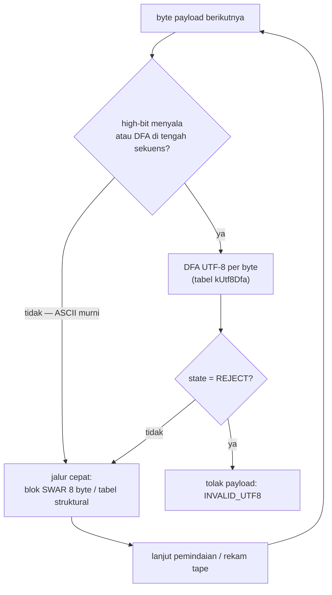

# Arsitektur: Scanner & Tape

> Bagian dari [docs/architecture/](.) — kembali ke
> [overview.md](overview.md).

## Peran scanner

Scanner adalah satu-satunya komponen yang menyentuh seluruh payload. Tugasnya:

1. **Memvalidasi** payload: kutip string (termasuk pasangan escape),
   keseimbangan bracket, dan **UTF-8** (DFA Höhrmann, sejak Tahap 4
   terintegrasi langsung ke jalan pemindaian — bukan pass terpisah).
2. **Merekam tape**: daftar posisi byte setiap karakter struktural
   (`{ } [ ] , :` dan tanda kutip string), sebagai offset `uint64` dari
   awal payload.

Scanner **tidak membangun tree** dan **tidak mem-parse nilai** — angka,
`true/false/null` dilewati begitu saja; nilainya dihitung kemudian oleh
lapisan on-demand dari teks di antara entry tape.

## Tiga varian, satu format tape

| Varian | Pemilihan | Perbedaan |
|---|---|---|
| `scanner8` | selalu tersedia (fallback portabel) | semua lintasan byte-per-byte |
| `scanner64` | LE + 64-bit (default `create_session` di mesin ini) | body string dipindai per blok 8 byte (SWAR); validasi UTF-8 terintegrasi |
| `scanner32` | LE + 32-bit | seperti scanner64, tetapi validasi UTF-8 masih pass `utils::Utf8Validator` terpisah (jalur fallback yang tak teruji di sini) |

Pemilihan dilakukan lewat makro `__LITTLE_ENDIAN__` / `__IS_64_BIT__` di
`create_session` (`src/ze_json.cpp`). **Format tape ketiganya identik** —
dijamin oleh uji kesetaraan `tests/scanner_test/`.

## Format tape

| Elemen JSON | Entri tape | Catatan |
|---|---|---|
| Karakter struktural (`{ } [ ] , :`) | **1** | posisi byte karakter |
| String | **2** | posisi kutip pembuka & penutup |
| `true` / `false` / `null` | **1** | posisi byte awal literal |
| Angka | **0** | teks angka hidup di *gap* antara dua entri — kursor elemen angka justru berada di terminatornya (`,` atau `]`/`}`) |

Konsekuensi angka 0-entri inilah sumber seluruh kehalusan kursor (lihat
[session.md](session.md)): `[]` dan `[1]` menghasilkan tape yang serupa dan
dibedakan lewat *gap* teks (satu-satunya konten non-whitespace berarti
ada elemen angka).

## Validasi UTF-8 terintegrasi (Tahap 4)

Dulu `utils::Utf8Validator` berjalan sebagai pass penuh TERPISAH sebelum
pemindaian — payload diwalk dua kali pada setiap `create_session`. Sejak
Tahap 4, langkah DFA menumpang jalan scanner:

Aturan integrasi:

- Byte ASCII dengan state DFA **ACCEPT** tidak menyentuh DFA sama sekali
  (transisi no-op) — biaya validasi murni ASCII nyaris nol.
- Blok 8-byte murni-ASCII + state ACCEPT tetap memakai jalur SWAR lama;
  blok yang memuat high-bit (atau saat DFA di tengah sekuens) diproses
  per-byte sehingga **sekuens multibyte aman terbelah di batas blok**.
- Byte struktural dan pasangan escape juga masuk DFA — kutip penutup di
  tengah sekuens wajib ditolak, identik dengan validator lama.
- Sekuens terpotong di akhir payload → `INVALID_UTF8`.

**Perubahan perilaku yang disengaja**: untuk payload yang sakit ganda
(struktural DAN UTF-8), galat yang dilaporkan kini bisa berbeda jenis dari
versi validator-terpisah (galit yang lebih dulu dijangkau jalan pemindaian
yang menang; dulu UTF-8 selalu menang karena divalidasi lebih dulu).
Keduanya tetap ditolak — hanya prioritas statusnya yang bisa berbeda.

## Validasi scope bertipe (v0.1.5)

Dahulu kedalaman bracket memakai satu counter agregat: jumlah `{}[]`
yang seimbang dianggap cukup — `["mismatch"}` (penutup jenis salah,
jumlah seimbang) lolos. Kini **satu counter per JENIS**: `{`/`}` dan
`[`/`]` dihitung terpisah; penutupan jenis yang salah ditolak SEKETIKA
sebagai *underflow jenis* (per `langdale_parsing_2019` §3.2 — objek
dibuka `{` wajib ditutup `}`, array `[` wajib `]`), dan akhir payload
menuntut kedua counter nol.

Batas terdokumentasi: saling-silang `[{]}` (jumlah per jenis seimbang,
urutan salah) tetap lolos — dua counter tak melacak urutan; itu ranah
stack scope tahap-2 (lihat [e2e-flow.md](e2e-flow.md)). Dikunci oleh
`scanner_test` (kedua varian wajib setuju) dan `json_checker_test`
(fail33 kini subset struktural).

## Kontrak galat scanner

| Kondisi | Status |
|---|---|
| Pointer null / ukuran kosong | `INVALID_JSON` |
| Buffer tape kurang | `INSUFFICIENT_BUFFER` |
| Bracket tak seimbang (terpotong / tutup berlebih) | `INVALID_JSON` |
| Bracket TAK COCOK JENISNYA (`{` ditutup `]` dst., v0.1.5) | `INVALID_JSON` |
| Kutip tanpa penutup / escape di ujung payload | `UNEXPECTED_QUOTE` |
| UTF-8 rusak (DFA REJECT / sekuens terpotong di akhir) | `INVALID_UTF8` |
| Lolos semua | jumlah entri tape ditulis ke `result`, status `OK` |

## Berkas terkait

- Implementasi: [`src/scanner/scanner.cpp`](../../src/scanner/scanner.cpp)
- Tabel struktural & DFA: [`include/ze_json/lookups/`](../../include/ze_json/lookups/)
- Util SWAR: [`include/ze_json/utils/swar.hpp`](../../include/ze_json/utils/swar.hpp)
- Uji: [`tests/scanner_test/`](../../tests/scanner_test/) (termasuk sekuens
  multibyte terbelah batas blok 8 byte, kesetaraan scanner8/64, dan
  kesetaraan penolakan)
