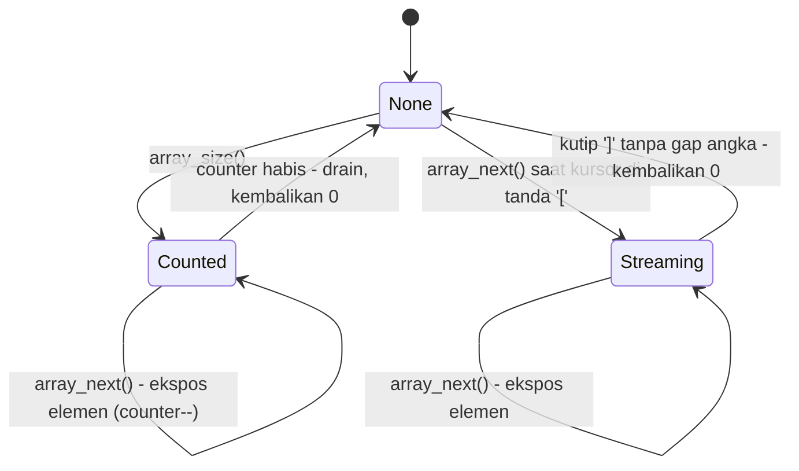

# Arsitektur: Session, Kursor & Traversal

> Bagian dari [docs/architecture/](.) — kembali ke
> [overview.md](overview.md).

## Session — satu kursor di atas tape

`Session` (di `include/ze_json/ze_json.hpp`) memegang:

- `Document` — pembungkus `JsonIterator` (kursor: `src`, `tape`,
  `current_idx_`) plus arena;
- `root_obj_` — pegangan `JsonObject` untuk pencarian field root;
- `value_` — nilai yang SEDANG dipegang kursor (hasil `find`/`find_path`/
  `array_next`);
- mesin traversal array + indeks lazy (root & elemen array).

**Kursor forward-only**: seluruh state posisi adalah satu indeks tape.
Nilai dibaca dengan melihat karakter struktural saat ini dan *gap* teks di
sekitarnya; setiap getter memajukan kursor melintas nilai yang dibaca.

## Ritme kursor & kontrak drain

Aturan penting yang menjaga ritme tetap koheren:

- **Angka (0 entri)**: kursor elemen angka berada di terminatornya (`,` /
  `]` / `}`). `get_int`/`get_double` membaca teks dari *gap* sebelum
  kursor, lalu maju satu entri.
- **`null` (1 entri)**: harus **dikonsumsi** (`consumeNull()` di JS, atau
  getter mana pun) sebelum pencarian berikutnya — tanpa itu karakter `n`
  tersisa mengacaukan ritme.
- **Drain array**: `array_next()` wajib dipanggil sampai mengembalikan `0` —
  langkah terakhir itulah yang mengantar kursor keluar dari `]` menuju
  ritme induk. `find()` MENGAMPUNI kursor `]`-sisa (satu langkah keluar),
  tetapi drain tetap disarankan.
- **`find()` kumulatif hanya maju**; `find_path()` selalu me-rewind dari
  root — itu satu-satunya cara kueri independen.

## Dua pola traversal array

Sejak v0.1.2 mesin traversal mengenal mode eksplisit
(`ArrayIterMode`):

- **Counted (kontrak lama)** — `array_size()` memanggil `count_elements()`
  (penghitungan inspektif: snapshot kursor, sapu penuh, restore) lalu
  counter menjadi otoritatif.
- **Streaming (baru, Tahap 3)** — langsung `while (array_next())` tanpa
  `array_size()`: satu lintasan, habis dideteksi murni dari kursor.
  Hasil identik dengan counted; diukur ~0,83× waktu counted untuk 1024
  elemen.

**Kasus paling licik** — elemen ANGKA TERAKHIR (0 entri): getter angka
memindahkan kursor MELAMPAUI `]` sebelum `array_next` berikutnya tiba,
sehingga kursor tak terbedakan dari ritme root. Penanganannya: penanda
`array_final_number_` (diekspos via cabang `']'` + *gap* angka, atau via
*lookahead* `','` — `peek_char_at`/`has_inline_number_at`); panggilan
berikutnya menutup array dengan drain yang sama.

`find_path()` me-reset seluruh mesin (`mode = None`) — kueri path dan
traversal tidak saling bocor. Over-drain (memanggil `array_next` setelah 0)
aman: tetap 0 tanpa korupsi ritme.

## Path query

`find_path` + `get_*_at` menggabungkan navigasi + cek tipe + pembacaan
dalam **satu panggilan C ABI**. Sintaks (byte tegas):

| Segmen | Makna |
|---|---|
| `key` | field object — pencocokan byte-exact terhadap teks kunci mentah |
| `[N]` | elemen array ke-N (basis 0) |
| `.` | pemisah segmen |
| campuran | `position.x`, `colors[1]`, `items[3].name`, `mix[4][1]` |

Status khusus: `INVALID_PATH` (sintaks salah), `NOT_FOUND` (jalur tak
sampai), `TYPE_MISMATCH` (nilai ditemukan tapi tipe tak cocok dengan getter).

## Indeks lazy (Tahap 2 & 4) — mengapa path jauh tetap O(1)

`find_path` me-rewind dan menelusuri ulang tiap kueri; tanpa indeks, kunci
terakhir objek 1024-field menyapu seluruh member (13 µs terukur), dan
`items[1023]` menyapu 1023 elemen. Dua indeks lazy memutus hukum linear
itu — kebijakan dan buktinya di
[optimizations.md](optimizations.md).

## Berkas terkait

- Implementasi: [`include/ze_json/ze_json.hpp`](../../include/ze_json/ze_json.hpp),
  lapisan on-demand di [`include/ze_json/ondemand/`](../../include/ze_json/ondemand/)
- Uji ritme kursor: [`tests/session_test/`](../../tests/session_test/),
  [`tests/array_test/`](../../tests/array_test/) (streaming=counted,
  angka 0-entri, ambigu `'[1]'` vs `'[]'`, over-drain)
- Uji path: [`tests/path_test/`](../../tests/path_test/) (4 asersi indeks
  root + 4 asersi indeks elemen array)
