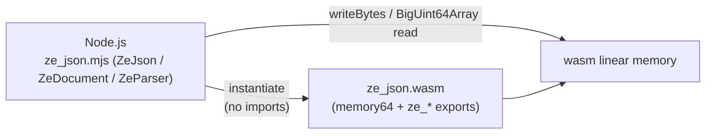

# wasm64 C-ABI surface (v3)

`src/abi/cabi.cpp` compiles to real exports only on wasm targets
(`EXPORT_NAME`), and compiles out on native. Contract header:
`include/ze_json/abi/cabi.hpp` (single source of truth, mirrored by
`bindings/js/ze_json.mjs`; `kAbiVersion = 3`).

| Export group | Signature | Notes |
|---|---|---|
| `ze_abi_version` | `() -> u64` | constant `kAbiVersion` (3) |
| `ze_alloc` | `(size) -> ptr` | 16-byte aligned bump allocator from linker `__heap_base` |
| `ze_reset_heap` | `() -> void` | rewind between corpora; v3 also closes every parser slot first |
| `ze_scanner8` / `ze_reference_scan` / `ze_scanner64` / `ze_scanner128` / `ze_structural_scan` | `(src, len, dst, cap) -> u64` | scanner surface (v2): packed ok = count, error = `code << 32`; the caller picks the variant per scan (`SCANNER_MODES` in the binding) |
| `ze_parser_open` / `ze_parser_root` / `ze_parser_close` | slot + args -> u64 | parser surface (v3): `Document::open` / `get_root` / teardown on one slot |
| `ze_value_kind` / `ze_get_string` / `ze_get_number` / `ze_get_bool` / `ze_is_null` / `ze_count_elements` | `(slot, token_start, ...) -> u64` | lazy scalar access (V8-locked string/number semantics) |
| `ze_container_begin` / `ze_array_next` / `ze_object_next` / `ze_object_field` | `(slot, frame...) -> u64` | step family: ok = `(cursor << 32) \| token_start`, done = `kStepSentinel << 32` |
| `memory` | exported memory64, 64 MiB initial | `dst` entries are 64-bit `size_t` |

Parser calls operate on one slot of a static pool (`kParserSlotMax` = 64;
one Arena + one `Document` per slot). Traversal is stateless per call: the
`(cursor, token_start)` frame pair a step returns is fed back as full-width
u64 arguments, and the ABI rebuilds the real C++ iterator from it — no
framing logic is duplicated on the ABI side. The slot-pool decision is
recorded as ADR [0003](../adr/0003-abi-v3-slot-pool.md).

Differential guarantee for the binding: `npm run differential` compares wasm
`scanner8`, wasm `reference_scan` and a plain JS reference across the corpus
documents and json_checker cases (must agree).

Related: [`ondemand-parser.md`](ondemand-parser.md) — the C++ parser behind
the parser-surface exports; [`../development/README.md`](../development/README.md)
— what to bump when this contract changes.
