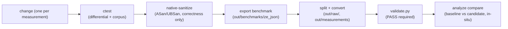

# Development guide (skeleton — full content in P6)

How to build, test, and measure `ze_json` from this workspace. All commands
run from the workspace root unless noted; `ze_json` builds only from here
(CMake presets point at the portable toolchain under `.toolchains/`).

## Build & test

```sh
# non-interactive sessions MUST activate the environment first (PATH, TOOLCHAINS_DIR,
# CORPUS_DIR, OUT_DIR, VCPKG_VISUAL_STUDIO_PATH)
scripts\env\activate.bat

cmake --preset native-release        # or: native-{debug,sanitize,pgo}, wasm64-{debug,release}
cmake --build build/native-release   # clang-tidy runs automatically on native targets
ctest --test-dir build/native-release --output-on-failure
```

- `native-sanitize` exists for correctness only (ASan/UBSan) — never benchmark it.
- `native-debug` is instrumented (`-fprofile-instr-generate -fcoverage-mapping`) — not for numbers.
- wasm64 builds are freestanding (`-nostdlib --no-entry`, C-ABI); the POST_BUILD
  step copies `ze_json.wasm` into `bindings/js` automatically.

## Correctness gates (before any performance claim)



- Keep the scalar reference (`reference_scan`) untouched as the correctness
  anchor; every fast path must stay byte-identical to it (differential test).
- One change per measurement; revert and record negative results honestly.
- Never compare numbers across machines, presets, git hashes, or corpora.

## Measurement workflow (P1-6 pipeline)

1. `cmake --build build/native-release --target export_benchmark_ze_json_scanner_benchmark`
   — runs the instrumented benchmark, writes the raw gbench JSON plus the
   metadata sidecar (contract in `benchmarks/export_sidecar.hpp`) under
   `out/benchmarks/ze_json/`.
2. Archive exhibits to `out/raw/<run_id>/`, then split per corpus:
   `python scripts/measurement-schema/split-gbench.py <raw.json> --out-dir out/raw/<run_id>`
3. Convert + validate one record per corpus (converter refuses to write a
   record without a complete `rationale`):
   `python scripts/measurement-schema/convert-gbench.py ...`
4. Analyze:
   `python scripts/analyze_measurement/main.py summary|compare|trend ...`

TODO(P6): add the PR workflow section (branch naming, template sections,
measurement-evidence checklist) and a troubleshooting table (vcpkg/MSVC path
notes) — see `AGENTS.md` section 8 in the meantime.
