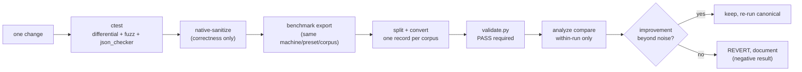
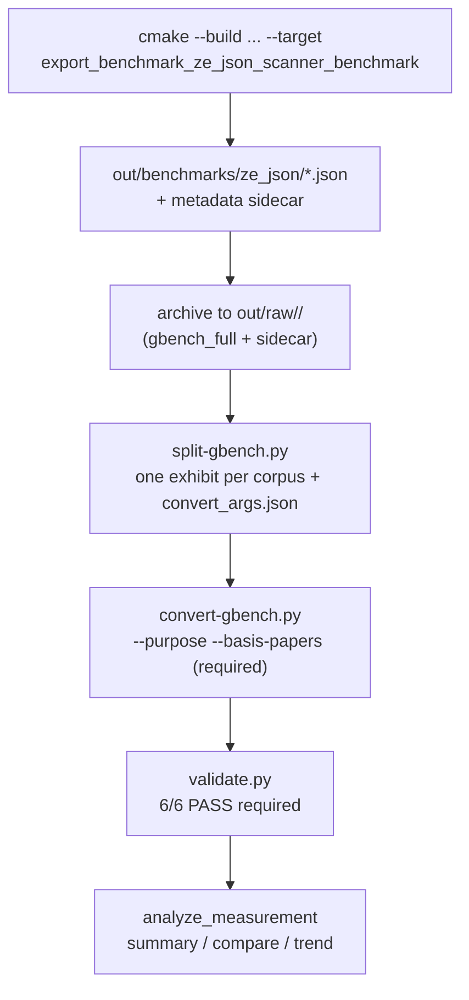

# Development guide

How to build, test, and measure `ze_json` from this workspace. All commands
run from the workspace root unless noted. `ze_json` builds **only** from here
(CMake presets point at the portable toolchain under `.toolchains/`).

## 1. Build & test matrix

```sh
# non-interactive sessions MUST activate the environment first
# (PATH, TOOLCHAINS_DIR, CORPUS_DIR, OUT_DIR, VCPKG_VISUAL_STUDIO_PATH)
scripts\env\activate.bat

cmake --preset native-release        # or native-{debug,sanitize,pgo}, wasm64-{debug,release}
cmake --build build/native-release   # clang-tidy runs automatically on native targets
ctest --test-dir build/native-release --output-on-failure
```

| Preset | Purpose | Caveat |
|---|---|---|
| `native-release` | measured builds + tests | the only numeric basis |
| `native-debug` | coverage-instrumented | never benchmark it |
| `native-sanitize` | ASan/UBSan correctness | never benchmark it; x64 link needs the optional MSVC ASan component (`stl_asan.lib`) |
| `native-pgo` | GENERATE → run benchmark → `ninja pgo_merge` → rebuild (USE) | owner decision (PLANS §7); mind cross-session clock drift |
| `wasm64-release` | freestanding memory64 C-ABI artifact | POST_BUILD copies `ze_json.wasm` to `bindings/js` |

vcpkg (manifest mode) provides `gtest` and `benchmark`; the manifest install
runs during configure. On this machine vcpkg needs
`VCPKG_VISUAL_STUDIO_PATH` pointing at a valid MSVC instance (see §5).

## 2. Correctness gates (before any performance claim)



- Keep `reference_scan` untouched as the correctness anchor; every variant
  must stay index-identical to it (differential test, all variants).
- One change per measurement. Revert and document negative results — both
  P4 vector experiments were rejected this way and remain as tested variants.
- Compare **within one run only**: cross-session clock drift on the dev
  laptop moved scanner8 by 727→934→895 MB/s on identical code (P4 report).
- Sanitizer runs are for correctness, never for numbers.

## 3. Measurement pipeline (canonical procedure)



Concrete commands (root workspace):

```sh
# 1. build + run via the export helper (writes gbench JSON + sidecar)
cmake --build ze_json/build/native-release --target export_benchmark_ze_json_scanner_benchmark

# 2. archive + split
python scripts/measurement-schema/split-gbench.py out/raw/<run_id>/gbench_full.json ^
       --out-dir out/raw/<run_id> --label saq=saq_payload_v1

# 3. convert (one record per corpus; rationale is mandatory)
python scripts/measurement-schema/convert-gbench.py <split.json> --out out/measurements/<run_id>_<corpus>_record.json ^
       --host .temp/host.json --git-commit <hash> --preset native-release ^
       --corpus-manifest-free args... --purpose "..." --basis-papers "<DOI>,<DOI>"

# 4. validate + analyze
python scripts/measurement-schema/validate.py out/measurements/<run_id>_*.record.json
python scripts/analyze_measurement/main.py summary --input <record>
python scripts/analyze_measurement/main.py compare --baseline <recA> --candidate <recB>
```

Node baselines (V8 / ze-wasm64) skip google-benchmark entirely:

```sh
node --expose-gc scripts/node-benchmark/harness.mjs --engine v8 --corpus all ^
     --repeats 5 --min-time-ms 300 --repo saq_report
node --expose-gc scripts/node-benchmark/harness.mjs --engine ze-wasm64 --corpus all ^
     --repeats 5 --min-time-ms 300 --repo ze_json
```

The harness writes the same schema-v1 records (one per corpus) plus raw
exhibits, embeds per-benchmark `rationale` (purpose + basis papers), and
verifies corpus bytes against the P0-8 manifests at load time.

## 4. Binding development (wasm64)

```sh
cd bindings/js
npm run smoke          # ABI + scan cases + in-module agreement
npm run differential   # corpus + json_checker: wasm scanner8 == wasm reference == JS reference
```

Any change to the C-ABI (`src/abi/cabi.cpp`, contract header
`include/ze_json/abi/cabi.hpp`) must bump `ze_abi_version` (currently v3:
scanner surface + on-demand parser slot pool) and update
`bindings/js/ze_json.mjs` + tests together. Memory is
module-exported memory64 (64 MiB initial); `dst` entries are 64-bit.

## 5. Known environment pitfalls

| Symptom | Cause | Fix |
|---|---|---|
| vcpkg "Unable to find a valid Visual Studio instance" | `.toolchains/MSVC` absent; `activate.ps1` points there | set `VCPKG_VISUAL_STUDIO_PATH` to a system BuildTools root (or run the bootstrap) |
| `stl_asan.lib` link error in `native-sanitize` | MSVC ASan x64 optional component not installed | install "C++ AddressSanitizer" via VS Installer (owner decision) |
| first configure fails at `find_package(GTest)` | manifest install raced the configure | re-run configure (second pass finds the installed packages) |
| `Select-Object -First N` kills a long node/python run in PowerShell | pipeline stop terminates the native process | redirect to a file or drop the truncation |
| filenames differ from expectation | this workspace uses `<run_id>_<corpus>_record.json` (underscore) | glob with `*_record.json`, never `.record.json` |
| git warns "LF will be replaced by CRLF" | `core.autocrlf=true` | harmless for text; corpus bytes are protected by `corpus/** -text` |

## 6. Git workflow

Branch → PR → merge (no direct pushes to `main`); Conventional Commits with
project scopes (`scanner`, `bench`, `binding-js`, `harness`, ...); PRs use
`.github/PULL_REQUEST_TEMPLATE.md` with the Measurement Evidence section
filled for anything performance-affecting. See `AGENTS.md` §8.

TODO(P6+): CI parity notes (`ci.yml`) and wasm64 build troubleshooting once
the npm package publishing flow is exercised end-to-end.
