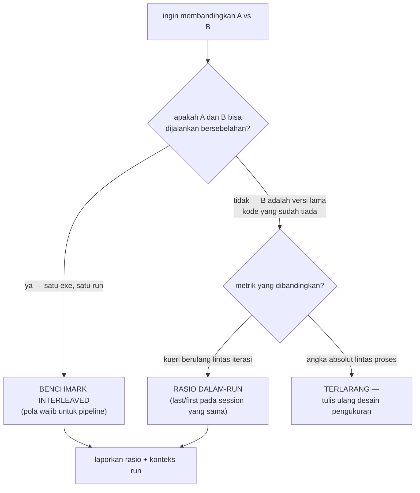

# Development: Benchmarking & Pengukuran

> Bagian dari [docs/development/](.) — lihat juga
> [workflow.md](workflow.md) · [testing.md](testing.md) ·
> [naming.md](naming.md). Bukti historis 4 tahap optimasi:
> [docs/architecture/optimizations.md](../architecture/optimizations.md).

## Hukum pertama: jam lintas-proses di mesin ini TIDAK SAH

Mesin pengembang ini menunjukkan getaran clock antar-proses **15–45%**
(terdokumentasi sejak Tahap 1). Akibatnya:



Dua pola yang sahih:

1. **Interleaved satu proses** — jalur baru dan REPLIKA jalur lama
   terdaftar sebagai benchmark bersebelahan dalam satu exe dan satu run
   (contoh historis: `BM_CreateSession_Pipeline_Scanner8` sebagai
   replika jalur lama vs `…Scanner64`; `BM_Pipeline_SeparateValidator`
   sebagai replika pass validasi terpisah vs jalur terintegrasi).
   Contoh aktif: `benchmarks/span_iso_benchmark/` (eksperimen A1) —
   slope marginal per-byte span non-string `scanner64` dibanding lawan
   replika ByteLoop/SWAR di satu proses; slope dihitung notebook §5b
   dari medians per Pad.
2. **Rasio dalam-run** — untuk kueri berulang, bandingkan rasio
   (mis. last/first) sebelum vs sesudah pada run masing-masing; hukum
   O(N) vs O(1) terlihat dari rasio itu, bukan dari ns absolut
   lintas-proses.

## Konvensi google-benchmark (grup `benchmarks/`)

- **1 kelompok = 1 folder**; daftar di
  [`benchmarks/CMakeLists.txt`](../../benchmarks/CMakeLists.txt) lewat
  `add_comprehensive_benchmark_target` (otomatis mendapat flag release +
  target ekspor laporan).
- `->Unit(kNanosecond) ->MinTime(30) ->MinWarmUpTime(3)` untuk grup
  session; fixture untuk payload konstan, **registri statis lazy** untuk
  kasus per-ukuran (`get_sized_case`, `get_wide_root_case`, …) — payload
  dibangun sekali, session hidup lintas iterasi bila semantiknya
  mengizinkan.
- **Payload sintetis deterministik** (generator di dalam benchmark) —
  tidak bergantung `samples/` (submodule) yang berat; generator bentuk
  dokumen konstan, hanya lebar yang menskalakan.
- **`SkipWithError` untuk setiap validasi** — jangan pernah mengukur jalur
  galat; `DoNotOptimize` untuk hasil yang dipakai.
- Session lintas iterasi vs per-iterasi: pilih sesuai semantik yang
  diukur (find_path me-rewind sendiri ⇒ session boleh dipakai lintas
  iterasi; alur per-langkah ⇒ `reset_arena` per iterasi).

### Gejala `0 ns, iters=1` = artefak, bukan hasil

Dua penyebab yang pernah terjadi: **(a)** benchmark exe menautkan library
basi — binary belum dibangun ulang setelah perubahan header (rebuild
targetnya!); **(b)** `SkipWithError` terpicu di iterasi pertama —
validasi di dalam loop gagal. Jangan pernah mencatat angka ini.

## Artefak: kebijakan ter-commit

- Semua artefak pengukuran hidup di
  [`out/results/benchmark/`](../../out/results/benchmark/) dan
  **ter-commit** — benchmark tanpa artefak dianggap tidak terjadi.
- Penamaan before/after per optimasi: `<topik>_before.json`,
  `<topik>_after_<deskripsi>.json` (contoh: `arrayread_before.json`,
  `rootwide_pathquery_after_index.json`, `tahap4_interleaved.json`).
- Ringkasan penuh: `node scripts/benchmark_metrics.js native-release`
  (→ `summary_<hash>.{json,md}`; `--parse-only` untuk merangkum ulang JSON
  yang ada tanpa menjalankan ulang).

## Benchmark JS

| Berkas | Peran |
|---|---|
| [`js/benchmark/sizes.mjs`](../../js/benchmark/sizes.mjs) | sapuan ukuran `JSON.parse` vs ze_json (95 B–256 KiB × 6 workload) |
| [`js/benchmark/copy.mjs`](../../js/benchmark/copy.mjs) | strategi salin payload ke wasm (encode+set vs encodeInto, interleaved) |
| [`js/benchmark/parse.mjs`](../../js/benchmark/parse.mjs) | perbandingan pada korpus simdjson (`samples/` — submodule) |

## Analisis artefak (opsional)

[`scripts/analyze_result/main.py`](../../scripts/analyze_result/main.py) —
notebook (`# %%` cells; bisa dijalankan headless atau di VS Code/Jupyter)
yang membaca seluruh `out/results/` lalu menginventory, mengklasifikasi
skema, dan membandingkan: pasangan eksperimen APAPUN dari run yang sama
(pair engine beraturan §5 — scanner8/64, replika Untyped/Integrated,
SeparateValidator, pola array), lantai noise yang diukur dari artefak
run-ulang (§3b, dipakai sebagai ambang pada before/after §6 dan
perbandingan revisi §6b berstatus deskriptif), titik berimbang sapuan
JS (§4b), audit bukti artefak tahap optimasi (§8b), dan laporan test.
Hormati hukum pertama di atas — grafik tren lintas file bersifat
deskriptif, bukan bukti kausal. Tabel hasil diekspor ke `out/analysis/`
(ter-ignore — turunan artefak, regenerable).

```bash
python -m venv .venv
.venv\Scripts\pip install -r scripts\analyze_result\requirements.txt
.venv\Scripts\python scripts\analyze_result/main.py   # MPLBACKEND=Agg di shell non-interaktif
```

Isolasi metrik `sizes.mjs` (pola untuk benchmark JS baru):

- payload dibangun & warm-up **di luar** pengukuran; bentuk dokumen
  konstan, hanya lebar array yang menskalakan;
- hasil kerja dituang ke **SINK module-level** (anti-DCE JIT);
- semua workload **satu proses, satu run**, pasangan JSON/ze
  bersebelahan dengan minTime identik;
- **hormati kontrak region**: payload ≤ 1 MiB dan TAPE region 131.072
  entri — payload sintetis ber-entri padat bisa kena
  `INSUFFICIENT_BUFFER` sebelum 1 MiB (sizes.mjs berhenti di 256 KiB).

## Resep: menambah benchmark baru

1. Buat `benchmarks/<nama>_benchmark/main.cpp` — ikuti konvensi di atas.
2. Daftarkan: `add_comprehensive_benchmark_target(<nama>_benchmark
   "${CMAKE_CURRENT_SOURCE_DIR}/<nama>_benchmark/main.cpp")`.
3. Rancang pembanding SAH sejak awal: butuh replika jalur lama
   bersebelahan? atau rasio dalam-run? (lihat diagram atas).
4. Jalankan: `cmake --build build/native-release --target <nama>_benchmark`
   lalu exe dengan `--benchmark_filter=… --benchmark_out=…`.
5. Simpan artefak before/after ke `out/results/benchmark/` (ter-commit)
   dan laporkan rasio + konteks run di body commit.
