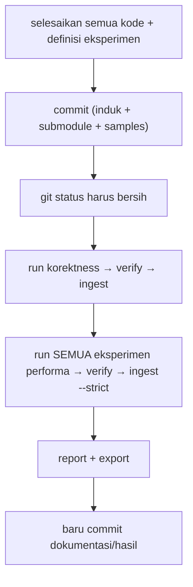

# Development: Walkthrough ze_json_research

> Bagian dari [docs/development/](.) — lihat juga
> [benchmarking.md](benchmarking.md) · [testing.md](testing.md) ·
> [research-integration.md](research-integration.md).

Dokumen ini narasi ujung-ke-ujung: dari shell bersih sampai angka yang bisa
dipertanggungjawabkan. Referensi perintah ada di
[`research/docs/cli.md`](../../research/docs/cli.md); dokumen ini menjelaskan
**urutan** dan **kenapa**, plus apa yang harus dilakukan ketika run ditolak.

Instalasi tooling dan penjelasan rancangannya ada di
[`research/README.md`](../../research/README.md).

---

## 0. Setup sekali jalan

```powershell
$env:ZE_JSON_SOURCE_DIR   = "D:\kuliah_\7_semester\skripsi\v3\src\ze_json"
$env:ZE_JSON_RESEARCH_HOME = "D:\kuliah_\7_semester\skripsi\research-data"
$env:VCPKG_ROOT           = "C:\Program Files\vcpkg"

cd "$env:ZE_JSON_SOURCE_DIR\research"                # repo research (submodule)
py -3.11 -m venv .venv
.\.venv\Scripts\Activate.ps1
python -m pip install -e ".[dev]"
ze-research init
python -m pytest -q          # 54 tes; hijau sebelum percaya apa pun dari sini
```

Tiga hal yang perlu dipahami sejak awal:

1. **Data root harus di luar kedua repo Git.** Ia bukan di dalam `ze_json`, bukan
   di dalam `research`, dan bukan di dalam folder induk `v3` — karena `v3` sendiri
   repo Git. Build tree, dataset 55 MB, SQLite, dan log akan menumpuk di sana.
2. **`VCPKG_ROOT` wajib untuk eksperimen native.** Runner menolak run bila
   placeholder `{vcpkg_root}` dipakai dan variabelnya kosong, alih-alih
   membangun toolchain rusak.
3. **Repo research adalah submodule.** Commit di dalamnya menggeser commit induk —
   konsekuensinya di §7.

---

## 1. Tiga penghalang sebelum run pertama

Semuanya diperiksa **sebelum satu perintah pun dijalankan**. Ketiganya memblokir,
bukan memperingatkan.

### a. Working tree induk harus bersih

`git status --porcelain --untracked-files=all` harus kosong. Yang sering
membuat kotor:

| Pemicu | Pesan yang muncul |
|---|---|
| Repo Git bersarang di dalam checkout (mis. `thesis/` dengan `.git` sendiri) | sangat sama dengan pesan di bawah; abaikan lewat `.gitignore` atau pindahkan keluar |
| Edit berkas apa pun di `research/` (termasuk docs) | "Run formal memerlukan working tree bersih…" |
| Pointer submodule `samples` bergererak | idem |
| Regenerasi snapshot `samples/saq-report/` | idem — lihat [json_baseline/README.md](../../benchmarks/json_baseline/README.md) |

```powershell
git status --short          # harus kosong
git submodule status        # catat commit keduanya; ia masuk ke manifest
```

### b. Dataset harus ada dan hash-nya cocok

Runner menghash setiap `dataset_path` **saat run dimulai**, dan membandingkannya
dengan `dataset_sha256` di definisi yang sudah direview. Berbeda → run dibatalkan:

```text
ERROR: Dataset workload 'github-events' berubah sejak definisi disetujui:
tercatat cfdc77cb…, ditemukan <lain>.
```

Sebagian besar karena submodule `samples` ter-checkout pada commit berbeda, atau
karena definisi belum diperbarui setelah snapshot baru diperbuat.

### c. Gerbang korektness harus terpenuhi

Eksperimen performa mendeklarasikan `correctness_gate`. Tanpa run
`correctness-gtest-suite` berstatus VERIFIED **pada commit yang sama**, run
ditolak:

```text
ERROR: Tidak ada run VERIFIED untuk eksperimen gate 'correctness-gtest-suite'
pada commit 'af23dc5f…'.
```

Karena itu urutannya selalu **korektness dulu, performa kemudian** — bukan
kebalikannya.

---

## 2. Validasi registry

```powershell
ze-research validate                  # struktural; draft boleh lolos
ze-research validate --for-run        # menuntut approved_for_run + referensi reviewed
ze-research list-experiments
```

`validate` dan `--for-run` menjawab pertanyaan berbeda. Yang pertama: "apakah
definisi masuk akal?" Yang kedua: "apakah manusia sudah mengaku memeriksa bukti
rujukannya?" Sebuah definisi `draft` lolos yang pertama dan ditolak yang kedua —
itu memang disengaja. `status: approved_for_run` dan `review_status: reviewed`
adalah deklarasi peneliti, bukan bukti otomatis bahwa klaimnya benar.

Saat menambah definisi baru, perhatikan juga jebakan YAML yang pernah memakan
waktu: item list biasa yang memuat `": "` berubah menjadi mapping dan ditolak
`validate_experiment` dengan "harus berupa array string" — kutip stringnya.

---

## 3. Preflight mapping sebelum run panjang

Besarnya run (jeopardy.json 55 MB, 64 registrasi × ~20 s) membuat cacat pemetaan
mahal: baru terlihat **setelah** run selesai, sebagai baris AMBIGUOUS/UNMAPPED.
Selesaikan lebih dulu:

```powershell
python ..\scripts\research\check-benchmark-mapping.py `
  --experiment parser-ondemand --target parser_benchmark `
  --build-dir <binary-dir-proyek>
```

Alat itu mendaftarkan apa yang benar-benar didaftarkan executable, membangun
`benchmark_specs` persis seperti yang akan dibuat importer, lalu melaporkan
pemetaan **kedua arah**: baris yang tak terpetakan, dan spec yang tak pernah
terukur. Exit code 0 berarti setiap nama terdaftar jatuh ke tepat satu
(varian, workload).

Tiga cacat yang pernah ditangkapnya:

- pola `BM_Fake_Baseline_{dataset}` + token `{Smoke}` salah tanda kurung;
- satu token `Case` untuk sembilan kasus fixture → sembilan UNMAPPED;
- nama fixture `ParserFixture/DocumentInitialization` hancur menjadi
  `ParserFixture` (normalisasi memakan segalanya setelah `/`).

Kalau `unmeasured` bukan nol, itu belum tentu cacat — sebuah varian yang sengaja
dibatasi ke beberapa workload memang tak punya spec untuk sisanya. Gunakan
`--allow-unmeasured-specs` setelah Anda pastikan itu memang disengaja.

---

## 4. Jalankan korektness (selalu lebih dulu)

```powershell
$runId = (ze-research run --experiment correctness-gtest-suite | ConvertFrom-Json).run_id
ze-research verify --run-id $runId      # hitung ulang semua hash + 8 hash biner
ze-research ingest  --run-id $runId     # 51 baris test_results
```

Run ini merekam: commit source, status submodule, hash kedelapan executable,
digest korpus `samples/JSON_checker`, log per langkah, dan JSON hasil per suite.
`verify` menolak bila ada byte yang bergeser.

Inilah run yang kemudian menjadi **gate** bagi setiap eksperimen performa. Simpan
`run_id`-nya.

---

## 5. Jalankan eksperimen performa

```powershell
$exp = "scanner-width-comparison"
$pair = "scanner8-library:scanner64-library"
$runId = (ze-research run --experiment $exp | ConvertFrom-Json).run_id
ze-research verify   --run-id $runId
ze-research ingest   --run-id $runId --strict
ze-research report   --experiment $exp --pair $pair --run-ids $runId
```

`--strict` adalah bagian penting dari alur, bukan tambahan: ia menolak import
bila ada baris hasil yang tak terpetakan ke tepat satu varian. Lebih baik ingest
gagal daripada punya angka berlabel salah yang masuk basis data.

Yang perlu dibaca dari laporan:

| Field | Gunanya |
|---|---|
| `run_ids` | run yang benar-benar menjadi dasar angka |
| `definition_sha256` / `definition_sha256_by_run` | versi definisi; kalau lebih dari satu, Anda sedang membacakan dua pertanyaan berbeda |
| `gates` | run korektness yang mendasarkan angka ini |
| `dataset_sha256` | byte persis yang diukur, bukan "dataset github events" |
| `unmapped_rows` | harus kosong untuk eksperimen formal |
| `benchmark_argument` | titik parameter (`/KiB:0`, `/Pad:8`) — sengaja tidak dirata-ratakan |

### Batas interpretasi

- `protocol.design: same_process_sequential` berarti registrasi berurutan dalam
  satu proses. Ia **bukan** interleaved per-iterasi; klaim yang menuntutnya butuh
  harness lain.
- Median diambil dari baris `run_type == "iteration"`. Sapuan parameter
  (`KiB`, `Idx`, `WxK`, `Pad`) tetap sebagai baris terpisah.
- Baris JS (`js_parse_results`) ber satuan µs/op dan tidak pernah dicampur dengan
  ns/op C++; `report` menolak perbandingan antar-satuan.
- Absolut lintas-proses bukan bukti kausal — hukum pertama ada di
  [benchmarking.md](benchmarking.md). Selalu bawa rasio + konteks run.

Hasil nyata yang mengingatkan pada batas ini: arah "scanner8 vs scanner64"
berbalik menurut ukuran payload, dan `BM_SpanReal_Hybrid_*` justru lebih lambat
di `twitter`. Ringkasannya di
[research-integration.md](research-integration.md).

### Pengulangan: wajib sebelum mengutip selisih

Satu run tidak bisa menentukan apakah sebuah selisih nyata, karena jam
antar-proses di mesin ini bergetar **15–45%**. Selisih 21% yang diukur sekali
tidak dapat dibedakan dari noise-nya.

```powershell
$exp = "scanner-width-comparison"
$pair = "scanner8-library:scanner64-library"

# N=3 adalah titik awal yang wajar; naikkan untuk klaim utama
$summaries = @()
foreach ($i in 1..3) {
  $runId = (ze-research run --experiment $exp | ConvertFrom-Json).run_id
  ze-research ingest --run-id $runId --strict
  $summaries += $runId
}
# atau sekali jalan (berurutan, tak pernah paralel):
ze-research run --experiment $exp --repeat 3
ze-research report --experiment $exp --across-runs --pair $pair
```

Yang dibaca dari laporan antar-run:

| Field | Pertanyaan yang dijawab |
|---|---|
| `n_runs`, `per_run_medians` | dari run mana saja angkanya |
| `median_of_run_medians`, `range_percent` | seberapa konsisten antar-run |
| `cv_across_runs` | apakah sebarannya masuk akal dibanding 15–45% |
| `outlier_run_ids` | run mana yang jamnya menyimpang (bernama, bukan dirata-rata) |
| `candidate_is_faster_in_all_runs` | apakah arahnya bertahan di semua pengulangan |
| `ratio_basis: "per_run"` | rasio dihitung per-run, bukan dari median gabungan |

`--repeat 1` ditolak agar flag tidak menyiratkan ada pekerjaan yang tidak
terjadi, dan pengulangan **tidak pernah paralel** — benchmark bersamaan saling
mengotori pengukuran.

---

## 6. Ekspor untuk notebook

```powershell
ze-research export --experiment scanner-width-comparison
# → $env:ZE_JSON_RESEARCH_HOME\reports\research-export.json
```

Berkas itu memuat seluruh provenance per baris. Berkas ini — bukan tabel yang
ditulis ulang di dokumen — yang sebaiknya dipakai sebagai sumber grafik skripsi.

Notebook analisis bisa membaca data root research **langsung**, bersama artefak
lama `out/results/`:

```powershell
$env:ZE_JSON_RESEARCH_HOME = "D:\kuliah_\7_semester\skripsi\research-data"
$env:MPLBACKEND = "Agg"
python .\scripts\analyze_result\main.py
```

Akibatnya dari segi data: setiap run research menjadi satu "file" bagi pair
engine (pasangan tetap dalam satu run), baris membawa `provenance`, `run_id`, dan
`revision` (commit dari manifest), dan lantai noise mengelompokkan pengulangan
satu eksperimen lewat `replica_group`. Notebook kini juga menemukan 10 run
research dan melaporkan 6 baris baseline JS dalam µs/op.

---

## 7. Aturan commit di antara run

Ini bukan aturan administrasi; gerbang membandingkan commit induk, **dan pointer
submodule `research/` ikut menggeser commit itu**. Akibatnya, satu commit
kecil pun membatalkan sahnya run korektness yang sudah ada.



Bentuk kegagalan yang akan Anda temui: run performa tertolak dengan
"Tidak ada run VERIFIED … pada commit 'X'" padahal run korektness sudah pernah
berhasil. Sebabnya commit Anda bergerakan setelah run korektness, bukan karena
run korektness hilang. Perbaikannya menjalankan ulang korektness pada commit
sekarang — bukan melewati gate.

Aturan praktisnya: **commit lebih dulu, run kemudian; dokumentasi terakhir.**
Jika Anda harus memperbaiki kode di tengah sesi run, hentikan, perbaiki, commit,
lalu mulai lagi dari langkah korektness.

Khusus pengulangan: seluruh set harus berada pada **satu commit**. Karena
`--repeat N` menjalankan semuanya dalam satu sesi, ini otomatis terpenuhi —
asalkan Anda tidak commit di antaranya. Bila sebuah pengulangan tertolak gate,
penyebabnya bukan pengulangan itu yang rusak, melainkan commit yang bergerak
sejak run korektness.

---

## 8. Tabel pemecahan masalah

| Pesan / gejala | Sebab nyata | Yang dilakukan |
|---|---|---|
| `Run formal memerlukan working tree bersih` | ada perubahan tak di-commit di induk, di submodule, atau repo bersarang | `git status -uall`; commit/pindahkan yang mengotori |
| `Dataset workload '…' tidak ditemukan` | `dataset_path` bukan berkas, atau submodule `samples` belum di-checkout | checkout submodule; perbaiki path |
| `Dataset workload '…' berubah sejak definisi disetujui` | digest tak cocok: snapshot baru atau submodule berpindah commit | perbarui `dataset_sha256` (sumber: `dataset-digests.json`) lalu commit |
| `Tidak ada run VERIFIED untuk eksperimen gate …` | commit induk bergerak setelah run korektness | ulangi korektness pada commit sekarang |
| `Pemeriksaan formal lulus…` tetapi run ditolak | `status`/`review_status` belum diset | review rujukan lalu setujui; jangan cuma menyalakannya |
| `Placeholder command tidak dikenal` | typo placeholder, atau brace literal tanpa `{{`/`}}` | rujuk daftar placeholder di [registry.md](../../research/docs/registry.md) |
| `Definisi memakai placeholder {vcpkg_root} tetapi VCPKG_ROOT tidak diset` | env toolchain belum diset | set `VCPKG_ROOT`, lalu ulangi |
| `Eksperimen '…' harus berstatus 'approved_for_run'` | definisi masih draft | setujui setelah review |
| `Referensi '…' belum berstatus reviewed` | rujukan belum diperiksa manusia | periksa, tulis evidence_note + locator |
| `harus berupa array string` (pada `limitations`/`assumptions`) | item list memuat `": "` sehingga jadi mapping YAML | kutip string, atau buang titik duanya |
| `Varian '…' wajib memiliki benchmark_token` | pola memakai `{dataset}`/`{case}` padahal workload tanpa token | beri token per workload, atau batasi via `variants[].workloads` |
| `pola literal … berlaku untuk N workload` | pola tanpa placeholder dipakai untuk banyak workload | beri `{dataset}` + token, atau batasi ke satu workload |
| Ingest `--strict` gagal dengan daftar AMBIGUOUS | dua workload berbagi token sehingga pola tabrakan | batasi `variants[].workloads` seperti kasus slot `Synth` |
| `VERIFIED` tetapi semua baris `real_time` kosong | benchmark di-`SkipWithError`: dataset gagal dimuat atau build basi | baca log stdout langkah run; rebuild target |
| `0 ns, iters=1` pada artefak | binary menaut library basi | `cmake --build … --target <target>` |
| Laporan exit code 1 | baris tak terpetakan atau pasangan tak lengkap | baca `unmapped_rows`/`unverifiable_comparisons` |
| `export` tanpa `--experiment` | aman: eksperimen tanpa baris benchmark hanya dilewati | tidak perlu tindakan; lihat `skipped_experiments` |
| `--repeat 1 tidak diizinkan` | N=1 hanyalah default tanpa flag | hapus flagnya, atau pakai N >= 2 |
| `pengulangan N/M berstatus FAILED` | langkah gagal di pengulangan itu; loop berhenti | baca log langkah pada run yang disebut; perbaiki, lalu ulangi dari korektness |
| `outlier_run_ids` memuat sebuah run | jam menyimpang pada run itu (gejala yang dikhawatirkan) | kutip median antar-run; jangan rata-ratakan run itu |
| `cv_across_runs` sangat besar | sebaran antar-run melebihi jangkauan 15–45% | tambah pengulangan; periksa ada beban lain di mesin |

---

## 9. Menambah eksperimen baru

1. Salin definisi terdekat dari `research/research/experiments/`.
2. Bangun executable-nya, lalu **preflight mapping** (§3) sebelum menulis
   `benchmark_name_pattern` apa pun.
3. Isi token per workload; batasi `variants[].workloads` ke workload yang
   benar-benar diimplementasikan. Pola dengan `{dataset}`/`{case}` menuntut token
   pada setiap workload yang dipakai varian tersebut.
4. Isi `dataset_sha256` dari `..\scripts\research\dataset-digests.json`
   (jalankan skrip itu bila dataset berubah).
5. Untuk baseline non-C++, pakai `mode: script` — lihat
   [json_baseline/README.md](../../benchmarks/json_baseline/README.md).
6. Biarkan `draft` sampai rujukannya benar-benar diperiksa. Baru setujui.
7. Jalankan alur dari §4. Kembalinya ke §7 bila Anda mengubah apa pun setelah
   run korektness.
