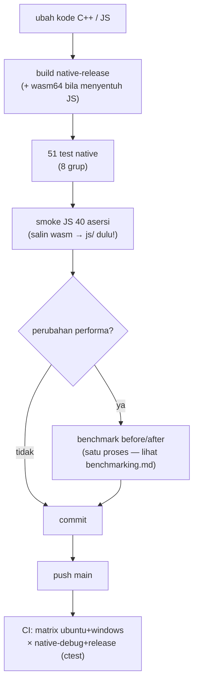
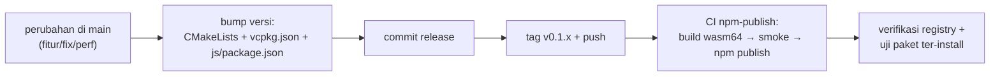

# Development: Workflow

> Bagian dari [docs/development/](.) — lihat juga
> [naming.md](naming.md) · [testing.md](testing.md) ·
> [benchmarking.md](benchmarking.md).

## Lingkungan & prasyarat

| Kebutuhan | Versi | Catatan |
|---|---|---|
| CMake | ≥ 3.40 (4.x dipakai) | runner CI memakai 4.4.4 |
| Toolchain | clang/LLVM (dev: 23) | wasm64 memakai `--target=wasm64` |
| Ninja | generator semua preset | |
| vcpkg | `VCPKG_ROOT` aktif | gtest + google-benchmark via manifest `vcpkg.json` |
| Node.js | ≥ 24 | memory64 aktif bawaan (uji/benchmark JS) |

## Preset build

Enam preset publik (warisan `base`: Ninja, clang, C++23,
`-Wno-c2y-extensions`, compile_commands aktif):

| Preset | Tujuan |
|---|---|
| `native-debug` / `native-release` | uji & benchmark native (vcpkg) |
| `wasm64-release` / `wasm64-debug` | binding JS (default produksi: release) |
| `wasm32-release` / `wasm32-debug` | fallback 32-bit (jarang dipakai) |

```bash
cmake --preset native-release && cmake --build build/native-release
cmake --preset wasm64-release && cmake --build build/wasm64-release
# → build/wasm64-release/src/ze_json_core.wasm
```

Flag optimasi release dikelola terpusat
[`cmake/modules/optimizations.cmake`](../../cmake/modules/optimizations.cmake)
(diterapkan ke library + semua benchmark): MSVC `/O2 /Ob3 /Gy /arch:AVX2`
+ `/OPT:REF,ICF`; Clang `-O3 -ffunction-sections -fdata-sections
-fno-exceptions -fno-rtti` (+ LTO bila IPO didukung).

## Siklus pengembangan harian



Disiplin commit: satu unit logis = satu commit; setiap `perf` wajib
membawa bukti benchmark di body; regresi penuh (native + smoke JS)
hijau sebelum commit.

## Gotcha harian (pelajaran berbayar)

- **`js/ze_json_core.wasm` adalah artefak LOKAL ter-ignore** — setelah
  rebuild wasm64, salin manual:
  `Copy-Item build\wasm64-release\src\ze_json_core.wasm js\`. Lupa
  menyalin = smoke JS menguji wasm lama dan gagal membingungkan.
- **Rebuild target benchmark setelah mengubah header** — benchmark exe
  menautkan `ze_json_core.lib`; binary basi menghasilkan artefak palsu
  (`0 ns, iters=1`) tanpa asersi gagal.
- **Script Node satu-baris di PowerShell rapuh** (backtick/quote) — tulis
  skrip `.mjs` di folder temp, jangan `node -e "…"`.
- **File kerja pribadi yang tak terlacak** (mis. `payload.json` di root)
  tidak disentuh dan tidak di-commit.

## Rilis (npm via CI)



Aturan rilis (diperbarui sejak v0.1.4-rc — versi kini TERSINKRON di tiga titik):

- **Bump versi di tiga tempat** + satu artefak tergenerasi — dan
  **setiap fix/fitur diawali bump versi di `CMakeLists.txt` DULU**
  (aturan sejak v0.1.5), menyusul dua titik lain:
  1. `CMakeLists.txt` — `project(ze_json VERSION x.y.z)`
  2. `js/package.json` — `version`
  3. `vcpkg.json` — `version`
  4. `include/ze_json/version.hpp` — **DIGENERASI otomatis** dari
     `cmake/templates/version.hpp.in` oleh `cmake/modules/generator.cmake`
     saat configure (ter-ignore; jangan edit/di-commit manual).
- Token npm lokal tidak dipakai (403) — publish SELALU lewat CI
  (`.github/workflows/npm-publish.yml`, trigger tag `v*`; CI membangun
  wasm sendiri, menjalankan smoke, lalu `npm publish`; skrip `prepack`
  menyalin wasm ke tarball).
- Verifikasi pasca-publish: `npm view @zuudevs/ze-json version`, lalu
  install di folder bersih dan jalankan alur ringan (path query, guard
  getter, streaming) — lihat [testing.md](testing.md).

## Struktur CI

| Workflow | Trigger | Isi |
|---|---|---|
| `ci.yml` | push/PR ke main | matrix `{ubuntu, windows} × {native-debug, native-release}`; CMake 4.4.4 + Ninja; `VCPKG_ROOT` per-OS; build lalu `ctest --output-on-failure` (gtest_discover_tests) |
| `npm-publish.yml` | tag `v*` | Node 24 → CMake 4.4.4 → LLVM 23 (symlink dipaksa) → build `wasm64-release` → smoke `node js/test/main.mjs` → `npm publish` |
